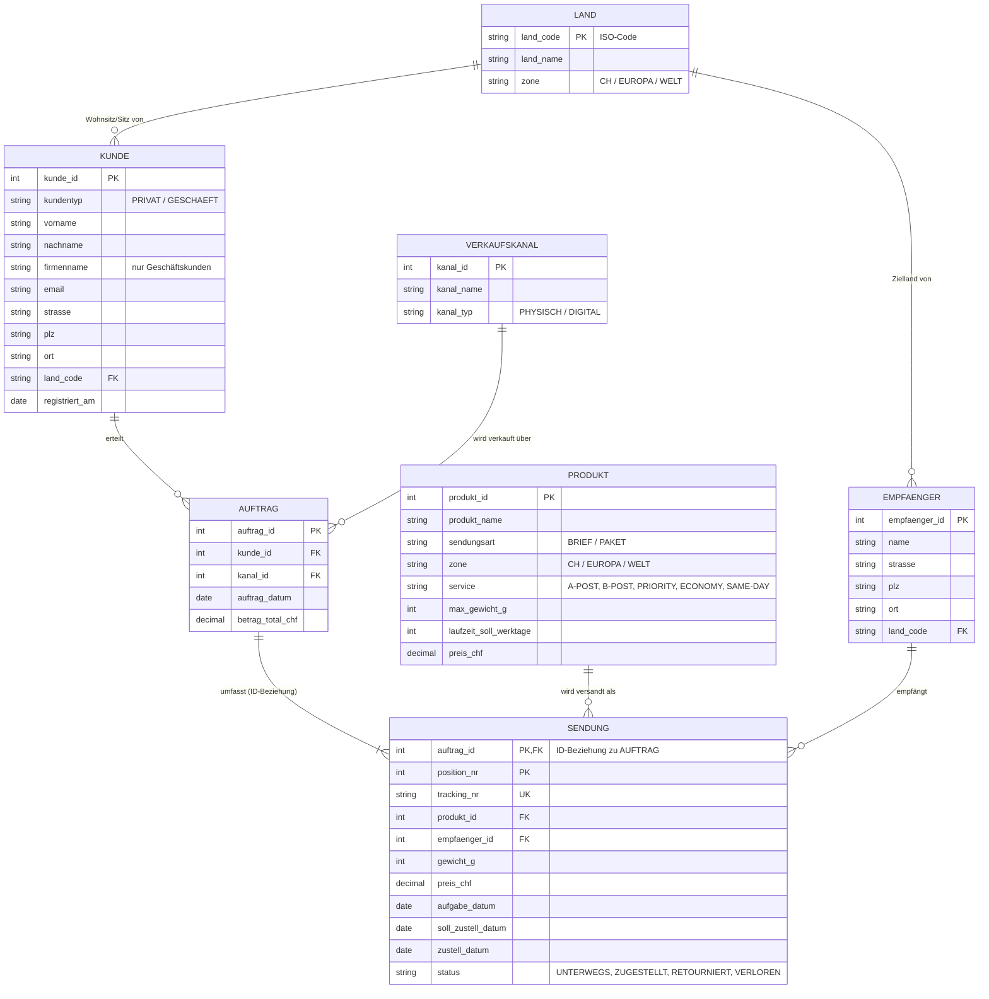
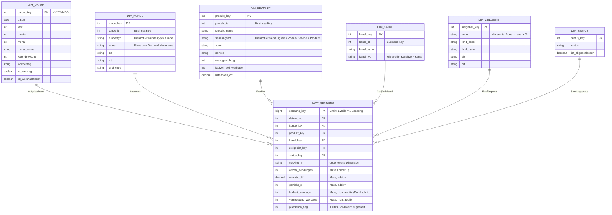
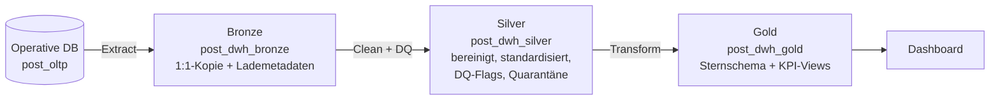

# Leistungsnachweis DB & DWH – Variante 1

**Operative Datenbank, Datawarehouse und Auswertung für den Brief- und Paketversand der Schweizer Post**

| | |
|---|---|
| Modul | Datenbanken & Datawarehouse (DB & DWH), ZHAW School of Engineering |
| Team | Dominik Erbsland, Joel Liechti |
| Abgabe | 30.11.2026 |
| Repository | <https://github.com/taar1/ZHAW_DB_DQH_Leistungsnachweis> |
| Werkzeuge | Databricks Free Edition (Serverless, Unity Catalog), Python, Mermaid, [Power BI] |

> **Hinweis zur Arbeit am Bericht:** Stellen mit **TODO** müssen wir noch ergänzen (Screenshots, Resultate aus
> Databricks, Interpretation). Die Diagramme liegen als Mermaid-Quellen in `docs/diagramme/` und sind hier
> eingebettet. Bei Änderungen beide Stellen nachführen.

---

## Inhaltsverzeichnis

1. [Ausgangslage und Geschäftsanwendung](#1-ausgangslage-und-geschäftsanwendung) (Aufgabe 1)
2. [Entitäten-Relationen-Modell](#2-entitäten-relationen-modell) (Aufgabe 2)
3. [Umsetzung der operativen Datenbank in Databricks](#3-umsetzung-der-operativen-datenbank-in-databricks) (Aufgabe 3)
4. [Beispieldaten](#4-beispieldaten) (Aufgabe 4)
5. [Informationsbedarf und Steuerungskennzahlen](#5-informationsbedarf-und-steuerungskennzahlen) (Aufgabe 5)
6. [Multidimensionales Datenmodell](#6-multidimensionales-datenmodell) (Aufgabe 6)
7. [Datawarehouse in der Medaillon-Architektur](#7-datawarehouse-in-der-medaillon-architektur) (Aufgabe 7)
8. [Datenqualitätsprüfungen im ETL-Prozess](#8-datenqualitätsprüfungen-im-etl-prozess) (Aufgabe 8)
9. [Auswertungsdashboard](#9-auswertungsdashboard) (Aufgabe 9)
10. [Fazit und Reflexion](#10-fazit-und-reflexion)
11. [Anhang](#11-anhang)

---

## 1. Ausgangslage und Geschäftsanwendung

### 1.1 Beruflicher Kontext

Wir arbeiten beide bei der **Schweizerischen Post**. Die Post verkauft Privat- und Geschäftskunden Versandleistungen
für Briefe und Pakete, im Inland wie ins Ausland. Verkauft wird über physische Kanäle (Postfilialen,
Filialen mit Partner, My Post 24-Automaten, Abholung pick@home) und über digitale Kanäle (Online-Porto/WebStamp,
Post-App, Geschäftskundenportal bzw. Versandschnittstelle). Jede verkaufte Sendung erhält eine Sendungsnummer
(Trackingnummer).

Für den Leistungsnachweis modellieren wir einen **vereinfachten Ausschnitt** dieses Geschäfts. Produkte und Preise
sind an das öffentliche Sortiment der Post angelehnt, aber vereinfacht. Alle Kunden- und Empfängerdaten sind
frei erfunden (synthetisch generiert).

### 1.2 Beschreibung der Geschäftsanwendung „Versand“

Die operative Anwendung unterstützt folgende Geschäftsprozesse:

1. **Kundenverwaltung:** Privatkunden und Geschäftskunden werden mit Name bzw. Firma, E-Mail und Adresse erfasst.
2. **Verkauf (Auftrag):** Ein Kunde kauft über einen **Verkaufskanal** eine oder mehrere Versandleistungen. Ein Kauf
   ist ein *Auftrag*.
3. **Sendungserfassung:** Jede Position des Auftrags ist eine **Sendung**. Sie verweist auf genau ein **Produkt**
   (z.B. *Paket Priority M*) und einen **Empfänger** und erhält eine eindeutige Trackingnummer.
4. **Zustellung:** Für jede Sendung werden das Aufgabedatum, das gemäss Produktlaufzeit versprochene Zustelldatum
   (Soll), das effektive Zustelldatum (Ist) und der Status (unterwegs, zugestellt, retourniert, verloren) geführt.

Bewusst **nicht** modelliert haben wir die einzelnen Ereignisse der Sendungsverfolgung (Scans in Sortierzentren),
Zusatzleistungen wie Einschreiben sowie die Standorte (Filialen, Sortierzentren). Sie würden das Modell deutlich
vergrössern, ohne für unsere Fragestellungen (Kapitel 5) nötig zu sein.

Die von der Aufgabenstellung geforderten Entitätstypen sind abgedeckt:

| Gefordert | Umsetzung im Modell |
|---|---|
| Kunde | `KUNDE` (Privat- und Geschäftskunden) |
| Produkt | `PRODUKT` (Briefe/Pakete, Inland/Europa/Welt, Service, Gewichts-/Formatklassen) |
| Verkaufskanal | `VERKAUFSKANAL` (7 physische und digitale Kanäle) |
| Beziehungen | Kunde *erteilt* Auftrag *über* Verkaufskanal; Auftrag *umfasst* Sendungen eines Produkts an einen Empfänger |

### 1.3 Produktsortiment (vereinfacht)

| Sendungsart | Zone | Services | Format- bzw. Gewichtsklassen | Preisbereich CHF |
|---|---|---|---|---|
| Brief | Inland (CH + FL) | A-Post (1 Werktag), B-Post (3 Werktage) | Standardbrief (B5, 100 g), Grossbrief (B4, 500 g), Maxibrief (B4, 1 kg) | 1.00 – 4.70 |
| Paket | Inland (CH + FL) | Economy (2 WT), Priority (1 WT), Same Day | S (bis 2 kg), M (bis 10 kg), L (bis 30 kg) | 9.00 – 49.00 |
| Brief | Europa | Priority, Economy | bis 20 g, bis 250 g, bis 2 kg | 2.20 – 18.00 |
| Brief | Welt | Priority, Economy | bis 20 g, bis 250 g, bis 2 kg | 2.50 – 32.00 |
| Paket | Europa | Priority, Economy | bis 2 kg, bis 10 kg, bis 30 kg | 31.00 – 115.00 |
| Paket | Welt | Priority, Economy | bis 2 kg, bis 10 kg, bis 30 kg | 42.00 – 230.00 |

Insgesamt sind es **37 Produkte**. Liechtenstein gehört tariflich zum Inland.

---

## 2. Entitäten-Relationen-Modell

### 2.1 ER-Diagramm

Quelle: [`docs/diagramme/erm_oltp.mmd`](../docs/diagramme/erm_oltp.mmd). Notation: Crow's Foot; `PK` = Primärschlüssel,
`FK` = Fremdschlüssel, `UK` = alternativer (fachlicher) Schlüssel.



> **TODO:** Für das PDF das Diagramm als Bild exportieren (z.B. mermaid.live → PNG) und hier einfügen.
> Ergänzend kann man einen Screenshot des ER-Diagramms aus dem Databricks *Catalog Explorer*
> (Schema `post_oltp` → Tabelle → *Relationships*) einfügen.

### 2.2 Entitätstypen

| Entitätstyp | Bedeutung | Schlüssel |
|---|---|---|
| `LAND` | Land mit Tarifzone (CH, EUROPA, WELT) | `land_code` (ISO 3166) |
| `KUNDE` | Absender/Käufer; Privat- oder Geschäftskunde, inkl. Adresse | `kunde_id` |
| `VERKAUFSKANAL` | Kanal des Verkaufs (physisch/digital) | `kanal_id` |
| `PRODUKT` | Versandprodukt mit Zone, Service, Gewichtslimite, Soll-Laufzeit und Preis | `produkt_id` |
| `EMPFAENGER` | Empfänger einer Sendung, inkl. Adresse | `empfaenger_id` |
| `AUFTRAG` | Kaufvorgang eines Kunden über einen Kanal | `auftrag_id` |
| `SENDUNG` | Position eines Auftrags = eine physische Sendung | (`auftrag_id`, `position_nr`); alternativ `tracking_nr` |

Die Adresse ist direkt in `KUNDE` bzw. `EMPFAENGER` gespeichert. Eine eigene Adresstabelle wäre normalisierter,
bringt für unsere Auswertungen aber keinen Mehrwert.

### 2.3 Beziehungen und Kardinalitäten

| Beziehung | Kardinalität | Erläuterung |
|---|---|---|
| Kunde – Auftrag | 1 : 0..n | Ein Kunde kann beliebig viele Aufträge erteilen; jeder Auftrag gehört zu genau einem Kunden. |
| Verkaufskanal – Auftrag | 1 : 0..n | Jeder Auftrag wird über genau einen Kanal abgewickelt. |
| Auftrag – Sendung | 1 : 1..n | **ID-Beziehung**, siehe 2.4. |
| Produkt – Sendung | 1 : 0..n | Jede Sendung ist genau ein Produkt. Daraus ergibt sich die geforderte **Kunde–Produkt-Beziehung** (m:n, aufgelöst über Auftrag und Sendung). |
| Empfänger – Sendung | 1 : 0..n | Ein Empfänger kann mehrere Sendungen erhalten. |
| Land – Kunde / Empfänger | 1 : 0..n | Die Zone des Empfängerlandes bestimmt, welche Produkte zulässig sind. |

### 2.4 Detaillierte ID-Beziehung: Auftrag → Sendung

Eine **ID-Beziehung** (identifizierende Beziehung) liegt vor, wenn eine *schwache Entität* ohne die übergeordnete
Entität nicht eindeutig identifiziert werden kann. Ihr Primärschlüssel enthält deshalb den Primärschlüssel der
übergeordneten Entität.

- Eine Sendung existiert nur im Rahmen eines Auftrags (*Existenzabhängigkeit*): ohne Kauf keine Sendung.
- Die Sendung wird über die laufende **Positionsnummer innerhalb des Auftrags** identifiziert:
  `PK(SENDUNG) = (auftrag_id, position_nr)`. `auftrag_id` ist gleichzeitig Teil des Primärschlüssels und
  Fremdschlüssel auf `AUFTRAG`.
- Kardinalität 1 : 1..n, denn jeder Auftrag hat mindestens eine Sendung.
- Wird ein Auftrag storniert, fallen auch alle seine Sendungen weg (kaskadierendes Löschen ist fachlich korrekt).

Beispiel aus den Daten: Auftrag 25 (Privatkunde, gekauft in der Postfiliale) umfasst fünf Sendungen:

| auftrag_id | position_nr | tracking_nr | Produkt | Empfänger (Land) |
|---:|---:|---|---|---|
| 25 | 1 | 98.01.100039.10001295 | Standardbrief A-Post | CH |
| 25 | 2 | 99.34.100039.10001332 | Paket Economy M | CH |
| 25 | 3 | 98.01.100039.10001369 | Standardbrief A-Post | CH |
| 25 | 4 | 99.60.100039.10001406 | Paket Priority M | CH |
| 25 | 5 | CP100002738CH | Paket International Welt Priority (bis 10 kg) | US |

`position_nr = 1` ist für sich allein nicht eindeutig (jeder Auftrag hat eine Position 1), erst zusammen mit
`auftrag_id`.

**Alternativer Schlüssel:** Die `tracking_nr` ist ebenfalls eindeutig und könnte als Primärschlüssel dienen. Wir haben
uns bewusst für die ID-Beziehung entschieden. Sie bildet die fachliche Abhängigkeit ab, und Sendungen können erfasst
werden, bevor die Trackingnummer bekannt ist (z.B. bei nachträglicher Etikettierung).

---

## 3. Umsetzung der operativen Datenbank in Databricks

Die operative Datenbank ist im Unity Catalog als Schema **`workspace.post_oltp`** umgesetzt
(DDL: [`sql/01_create_schema.sql`](../sql/01_create_schema.sql)). Alle 7 Tabellen sind **Delta-Tabellen**.

Umsetzungsentscheide:

- **Datentypen:** Geldbeträge `DECIMAL` (keine Rundungsfehler wie bei `DOUBLE`), Daten `DATE`,
  Postleitzahlen `STRING` (ausländische PLZ enthalten Buchstaben/Leerzeichen, z.B. „SW1A 1AA“).
- **Schlüssel:** `PRIMARY KEY`- und `FOREIGN KEY`-Constraints sind deklariert. In Databricks sind sie
  **informativ** und werden nicht erzwungen. Sie dokumentieren das Modell, werden vom Optimizer genutzt und erscheinen
  im Catalog Explorer. Die referentielle Integrität prüfen wir deshalb selbst im ETL (siehe Kapitel 8).
- **Erzwungene Regeln:** `NOT NULL` und `CHECK`-Constraints (z.B. `kundentyp IN ('PRIVAT','GESCHAEFT')`,
  `preis_chf >= 0`, gültige Sendungsstatus) werden von Delta Lake bei jedem Insert geprüft.
- **Dokumentation im Katalog:** Jede Tabelle und Spalte hat einen `COMMENT`.

Auszug aus der DDL:

```sql
CREATE TABLE post_oltp.sendung (
  auftrag_id           INT           NOT NULL COMMENT 'PK-Teil und FK auf auftrag (ID-Beziehung)',
  position_nr          INT           NOT NULL COMMENT 'PK-Teil: laufende Nummer der Sendung im Auftrag',
  tracking_nr          STRING        NOT NULL COMMENT 'Sendungsnummer (fachlicher Schlüssel)',
  produkt_id           INT           NOT NULL COMMENT 'FK auf produkt',
  empfaenger_id        INT           NOT NULL COMMENT 'FK auf empfaenger',
  ...
  CONSTRAINT pk_sendung PRIMARY KEY (auftrag_id, position_nr),
  CONSTRAINT fk_sendung_auftrag FOREIGN KEY (auftrag_id) REFERENCES post_oltp.auftrag (auftrag_id),
  ...
);
```

> **TODO:** Screenshot Catalog Explorer mit Schema `post_oltp` und den 7 Tabellen einfügen.

---

## 4. Beispieldaten

### 4.1 Vorgehen

Die Beispieldaten erzeugt ein Python-Skript ([`scripts/generate_data.py`](../scripts/generate_data.py)). Es
schreibt SQL-INSERT-Skripte (`sql/02_…` bis `sql/04_…`). Der Generator arbeitet mit einem **fixen Zufalls-Seed**,
die Daten sind also reproduzierbar. Er simuliert nicht einfach zufällige Zeilen, sondern den Geschäftsprozess:

- Kunden registrieren sich über die Zeit. Aufträge entstehen erst nach der Registrierung.
- Jeder Kunde hat einen **bevorzugten Kanal** (Geschäftskunden meist das Geschäftskundenportal, Privatkunden oft die
  Filiale oder die App). Digitale Kanäle gewinnen über die Jahre Anteile.
- Geschäftskunden verhalten sich unterschiedlich (E-Commerce = viele Pakete, Briefversender = viele Briefe) und
  erhalten 10 % Rabatt auf Pakete.
- **Saisonalität:** Spitzen im November (Black Friday) und Dezember (Weihnachten), wenig Aufträge an Sonntagen
  und Feiertagen. Leichtes Wachstum über die Zeit, Briefanteil rückläufig.
- Das **Produkt** passt zur Zone des Empfängers (ein Paket nach Deutschland ist immer ein Europa-Produkt), und das
  **Gewicht** liegt in der Gewichtsklasse des Produkts.
- **Zustellung:** Das Soll-Zustelldatum ergibt sich aus der Produktlaufzeit in Werktagen (ohne Wochenenden und
  Feiertage). Rund 6 % der Sendungen sind verspätet, in der Vorweihnachtszeit und in Bergkantonen mehr. Dazu kommen
  Retouren (Empfänger nicht angetroffen) und wenige verlorene Sendungen.
- **Trackingnummern** folgen dem Aufbau der Post: Inland `99.60.123456.12345678` (Paket) bzw. `98.xx…` (Brief),
  International im UPU-S10-Format inkl. Prüfziffer, z.B. `CP100002738CH`.

Zeitraum: **01.01.2024 – 09.11.2026**, Datenstand (Stichtag) 10.11.2026.

### 4.2 Datenmengen

| Tabelle | Zeilen |
|---|---:|
| land | 24 |
| verkaufskanal | 7 |
| produkt | 37 |
| kunde | 658 (528 privat, 130 geschäftlich) |
| empfaenger | 3'000 |
| auftrag | 5'687 |
| sendung | 12'134 |

### 4.3 Bewusst eingebaute Datenqualitätsprobleme

Operative Systeme enthalten in der Praxis immer fehlerhafte Daten. Damit die Datenqualitätsprüfungen im DWH
(Kapitel 8) etwas finden, haben wir folgende Probleme absichtlich eingebaut:

| Nr. | Problem | Tabelle.Spalte | Anzahl | Typische Ursache in der Praxis |
|---|---|---|---:|---|
| DQ1 | E-Mail fehlt oder ungültiges Format | `kunde.email` | 20 | Freitexterfassung am Schalter |
| DQ2 | Ungültige Schweizer PLZ (nicht 4-stellig) | `kunde.plz` | 6 | Tippfehler, „CH-8001“ |
| DQ3 | Uneinheitliche Ortsschreibweise (Zuerich, ZÜRICH, Genf) | `kunde.ort` | 10 | Mehrsprachigkeit, fehlende Normierung |
| DQ4 | Kunden-Dubletten (gleiche Person zweimal erfasst) | `kunde` | 8 | Neuregistrierung statt Login |
| DQ5 | Gewicht grösser als Produktlimite | `sendung.gewicht_g` | 109 | Falsches Produkt gewählt, Waage |
| DQ6 | Gewicht fehlt oder 0 | `sendung.gewicht_g` | 44 | Nicht gewogen |
| DQ7 | Zustelldatum vor Aufgabedatum | `sendung.zustell_datum` | 19 | Falsche Systemzeit eines Scanners |
| DQ8 | Empfänger existiert nicht (verwaister Fremdschlüssel) | `sendung.empfaenger_id` | 12 | FK nicht erzwungen, Löschung |
| DQ9 | Auftragstotal ≠ Summe der Sendungspreise | `auftrag.betrag_total_chf` | 43 | Manuelle Korrektur, Rundung |

Die Abfragen zum Erkennen dieser Probleme stehen in [`sql/05_pruefabfragen.sql`](../sql/05_pruefabfragen.sql).
(Die Dublettenprüfung über Name + Strasse findet 9 Fälle: Die 8 eingebauten und ein zufällig entstandenes Paar.)

---

## 5. Informationsbedarf und Steuerungskennzahlen

### 5.1 Anspruchsgruppen

| Rolle | Informationsbedarf |
|---|---|
| Geschäftsleitung Logistik | Entwicklung von Mengen und Umsatz, Strukturwandel Brief → Paket |
| Produktmanagement | Welche Produkte und Services werden genutzt? |
| Vertrieb / Key Account | Umsatz pro Kanal und Kundensegment, wichtigste Geschäftskunden |
| Betrieb / Qualitätsmanagement | Pünktlichkeit (Laufzeit-Einhaltung), Retouren, Verluste |

### 5.2 Steuerungskennzahlen (KPIs)

| KPI | Definition | Granularität |
|---|---|---|
| Sendungsmenge | Anzahl Sendungen | Tag/Monat, Produkt, Kanal, Zone |
| Umsatz CHF | Σ `preis_chf` | wie oben |
| Ø Umsatz pro Sendung | Umsatz / Sendungsmenge | Produkt, Kundensegment |
| Digitalisierungsgrad | Anteil Aufträge über digitale Kanäle | Monat, Kundentyp |
| Pünktlichkeitsquote | Anteil zugestellter Sendungen mit `zustell_datum ≤ soll_zustell_datum` | Service, Zone, Zielland, Monat |
| Ø Laufzeit | Werktage zwischen Aufgabe und Zustellung | Produkt, Zone |
| Retourenquote | Anteil Sendungen mit Status RETOURNIERT | Produkt, Kunde |

### 5.3 Fragestellungen

Diese Fragen soll das Datawarehouse beantworten. **F1 – F3 (mindestens) werden im Dashboard umgesetzt.**

- **F1 – Strukturwandel Brief/Paket:** Wie entwickeln sich Sendungsmenge und Umsatz pro Sendungsart (Brief/Paket) und
  Zone (Inland/Europa/Welt) von Monat zu Monat? Welche Saisonalität gibt es?
- **F2 – Verkaufskanäle:** Welcher Umsatz fällt pro Verkaufskanal und Kundentyp an, und wie verändert sich der Anteil
  digitaler Kanäle über die Zeit?
- **F3 – Pünktlichkeit:** Wie hoch ist die Pünktlichkeitsquote pro Service (A-Post, B-Post, Priority, Economy) und
  Zielzone? Sinkt sie in der Vorweihnachtszeit?
- **F4 – Top-Geschäftskunden:** Welche 10 Geschäftskunden erzielen den höchsten Umsatz, und welchen Anteil am
  Gesamtumsatz haben sie (ABC-Analyse)?
- **F5 – Internationaler Versand:** In welche Länder wird am meisten versandt, und welcher Anteil entfällt auf Priority?

---

## 6. Multidimensionales Datenmodell

### 6.1 Wahl des Geschäftsobjekts

Wir wählen die **Sendung** als Geschäftsobjekt. Sie ist das zentrale Ereignis, an dem sich alle Fragen aus
Kapitel 5 messen lassen (Menge, Umsatz, Laufzeit, Pünktlichkeit).

**Granularität (Grain):** Eine Zeile der Faktentabelle entspricht **einer Sendung**. Das ist die feinste verfügbare
Granularität. Damit lassen sich alle Kennzahlen beliebig aggregieren.

### 6.2 Sternschema

Quelle: [`docs/diagramme/sternschema_sendung.mmd`](../docs/diagramme/sternschema_sendung.mmd)



### 6.3 Dimensionen und Hierarchien

| Dimension | Hierarchie (grob → fein) | Wichtige Attribute |
|---|---|---|
| Datum (Aufgabedatum) | Jahr → Quartal → Monat → Tag; Jahr → Kalenderwoche → Tag | Wochentag, Werktag ja/nein |
| Kunde | Kundentyp → Kunde; Land → Ort → Kunde | |
| Produkt | Sendungsart → Zone → Service → Produkt | Maximalgewicht, Soll-Laufzeit, Listenpreis |
| Verkaufskanal | Kanaltyp (physisch/digital) → Kanal | |
| Zielgebiet | Zone → Land → Ort/PLZ | |
| Status | abgeschlossen ja/nein → Status | |

### 6.4 Kennzahlen (Fakten)

| Kennzahl | Additivität | Bemerkung |
|---|---|---|
| `anzahl_sendungen` | additiv | immer 1, vereinfacht das Zählen |
| `umsatz_chf` | additiv | |
| `gewicht_g` | additiv | |
| `laufzeit_werktage`, `verspaetung_werktage` | nicht additiv | nur Durchschnitt/Median sinnvoll |
| `puenktlich_flag` | semi-additiv | Summe/Anzahl = Pünktlichkeitsquote |

**Designentscheide**

- `tracking_nr` bleibt als **degenerierte Dimension** in der Faktentabelle (für den Drill-through zur einzelnen Sendung).
- Der Absender-Ort liegt in `dim_kunde`, der Empfänger-Ort in `dim_zielgebiet`. So lassen sich Versandströme
  (von → nach) analysieren.
- **Historisierung:** Für `dim_kunde` wäre eine SCD Typ 2 sinnvoll (z.B. bei Umzug). Im Rahmen dieser Arbeit
  setzen wir SCD Typ 1 (Überschreiben) um. *(TODO: definitiv entscheiden)*

---

## 7. Datawarehouse in der Medaillon-Architektur

Quelle: [`docs/diagramme/medaillon_architektur.mmd`](../docs/diagramme/medaillon_architektur.mmd)



| Schicht | Schema | Inhalt | Ladeart |
|---|---|---|---|
| Bronze | `post_dwh_bronze` | Unveränderte Kopie aller OLTP-Tabellen, ergänzt um `_ladezeitpunkt` und `_quelle` | Full Load (Overwrite) |
| Silver | `post_dwh_silver` | Bereinigte, typisierte, standardisierte Daten; jede Zeile mit DQ-Ergebnis; fehlerhafte Zeilen in Quarantäne-Tabellen | Full Load bzw. `MERGE` |
| Gold | `post_dwh_gold` | Sternschema (Fakten und Dimensionen) sowie aggregierte Sichten für das Dashboard | Full Load |

> **TODO (Team):** ETL-Notebooks in `databricks/` erstellen und hier beschreiben:
> - `10_bronze_laden` – Kopie per `CREATE OR REPLACE TABLE … AS SELECT *, current_timestamp() AS _ladezeitpunkt …`
> - `20_silver_bereinigen` – Standardisierung (Ort-Mapping, PLZ, E-Mail, Trim/Upper), DQ-Prüfungen, Quarantäne
> - `30_gold_sternschema` – Dimensionen mit Surrogatschlüsseln, `dim_datum` per `sequence()`, `fact_sendung`
> - Ablauf als Databricks *Job* (optional) und Screenshots der Lineage im Catalog Explorer.

---

## 8. Datenqualitätsprüfungen im ETL-Prozess

Gefordert sind mindestens zwei sinnvolle Prüfungen. Wir sehen folgende Prüfungen im Silver-Layer vor. Die Spalte
*Reaktion* beschreibt, was mit fehlerhaften Datensätzen passiert.

| ID | Prüfung (Dimension der Datenqualität) | Regel | Reaktion |
|---|---|---|---|
| P1 | **Referentielle Integrität** (Konsistenz) | Jede `sendung.empfaenger_id` existiert in `empfaenger` | Sendung in Quarantäne. In der Faktentabelle wird sie dem Dummy-Mitglied „Unbekannt“ (Key −1) zugeordnet, damit der Umsatz nicht verloren geht. |
| P2 | **Plausibilität** Gewicht (Korrektheit) | `gewicht_g > 0` und `gewicht_g ≤ produkt.max_gewicht_g` | Flag `dq_gewicht_ok = false`. Sendung zählt im Umsatz, wird aber nicht für Gewichtsauswertungen verwendet. |
| P3 | **Plausibilität** Zeitreihenfolge (Konsistenz) | `zustell_datum ≥ aufgabe_datum` | Laufzeit/Pünktlichkeit = NULL, Datensatz in Quarantäne-Report |
| P4 | **Formatprüfung** (Gültigkeit) | E-Mail per Regex, CH-PLZ 4-stellig | Wert normieren, sonst NULL setzen und flaggen |
| P5 | **Abstimmung** (Vollständigkeit/Konsistenz) | `auftrag.betrag_total_chf = Σ sendung.preis_chf` | Abweichung protokollieren; im DWH gilt die Summe der Sendungen |
| P6 | **Eindeutigkeit** | `tracking_nr` eindeutig; Kunden-Dubletten (Name + Strasse) | Dubletten markieren (`master_kunde_id`) |
| P7 | **Vollständigkeit** Ladeprüfung | Zeilenzahl Bronze = Zeilenzahl Quelle | Job bricht ab, wenn Abweichung |

Ergebnisse jeder Prüfung schreiben wir in eine Protokolltabelle `post_dwh_silver.dq_protokoll`
(Ladezeitpunkt, Prüfung, Tabelle, Anzahl geprüft, Anzahl fehlerhaft).

> **TODO (Team):** Mindestens P1 und P2 (besser P1–P5) umsetzen. Resultate (Anzahl gefundener Fehler, vgl. Tabelle in
> 4.3) und Screenshot des DQ-Protokolls einfügen. Optional: Delta *Expectations* in einer Lakeflow/DLT-Pipeline.

---

## 9. Auswertungsdashboard

> **TODO (Team):** Dashboard in **Databricks AI/BI Dashboard** (oder Power BI) auf Basis von `post_dwh_gold` erstellen.
> Für jede Frage: Screenshot, verwendete Abfrage und Interpretation (2–4 Sätze).

| Frage | Visualisierung (Vorschlag) |
|---|---|
| F1 Strukturwandel Brief/Paket | Liniendiagramm Sendungen pro Monat, Farbe = Sendungsart; gestapelte Balken Umsatz nach Zone |
| F2 Verkaufskanäle | Balken Umsatz pro Kanal (Farbe Kundentyp); Linie Anteil digitaler Kanäle pro Quartal |
| F3 Pünktlichkeit | Balken Pünktlichkeitsquote pro Service; Linie pro Monat (Dezember-Effekt sichtbar) |
| F4 Top-Geschäftskunden | Tabelle Top 10 + Pareto-Diagramm |
| F5 International | Karte bzw. Balken nach Land, Anteil Priority |

Erste Beobachtungen aus der operativen DB (Prüfabfragen, vor DWH):

- Pakete machen rund 60 % der Sendungen, aber über 90 % des Umsatzes aus.
- Deutlicher Peak im Dezember (2025: rund 1.6× so viele Sendungen wie im Juni).
- Die Pünktlichkeit liegt im Inland bei rund 94–97 %, international bei 76–87 %.

---

## 10. Fazit und Reflexion

> **TODO (Team):** Am Schluss schreiben, z.B.:
> - Was hat gut funktioniert (Generator, Git-Workflow mit zwei Free-Edition-Workspaces)?
> - Grenzen: synthetische Daten, informative Constraints in Databricks, kein inkrementelles Laden
> - Mögliche Erweiterungen: Sendungsverfolgung (Tracking-Ereignisse), Zusatzleistungen, SCD Typ 2, inkrementelles Laden mit Change Data Feed

---

## 11. Anhang

### 11.1 Dateien der Abgabe

| Datei / Ordner | Inhalt |
|---|---|
| `bericht.pdf` | Dieser Bericht |
| `post_leistungsnachweis.dbc` | Databricks-Export: SQL-Notebooks (`sql/`) und ETL-Notebooks (`databricks/`) |
| `*.pbix` (optional) | Power-BI-Dashboard |
| `INSTALL.md` | Installationsanleitung |
| `docs/diagramme/*.mmd` | Mermaid-Quellen der Diagramme |
| `scripts/generate_data.py` | Datengenerator |

### 11.2 Installationsanleitung

Siehe [`INSTALL.md`](../INSTALL.md). Kurzfassung: `.dbc` in Databricks importieren, Notebook `sql/00_setup_alles`
ausführen, danach die ETL-Notebooks in `databricks/` in nummerierter Reihenfolge.

### 11.3 Verwendung von KI-Werkzeugen

> **TODO:** Gemäss ZHAW-Richtlinien deklarieren, wofür KI-Werkzeuge verwendet wurden (z.B. Datengenerator,
> Entwurf der Berichtsstruktur) und wie die Resultate geprüft wurden.
