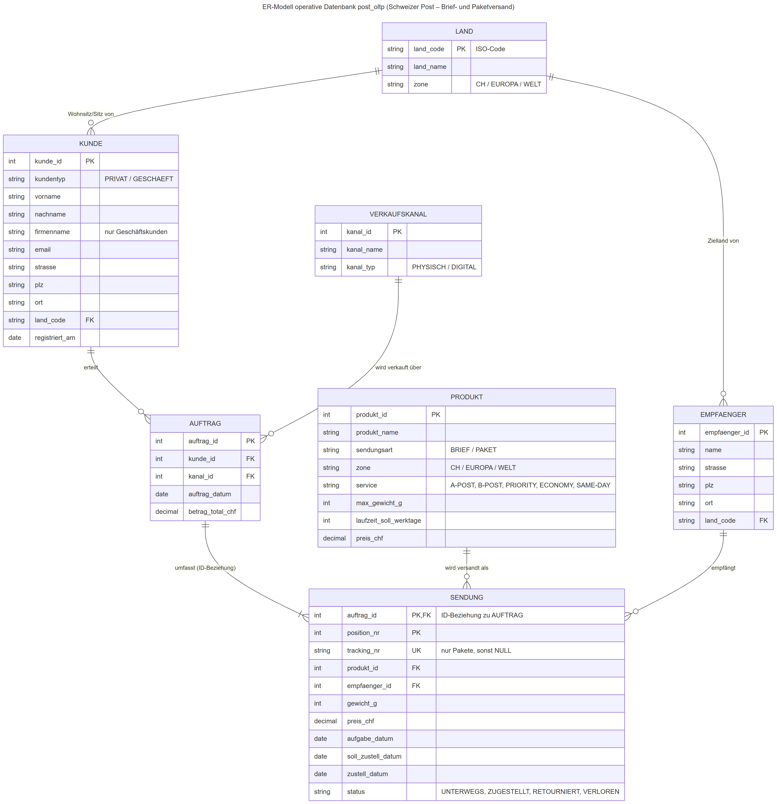
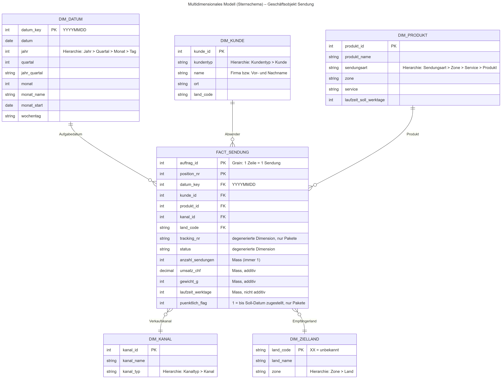
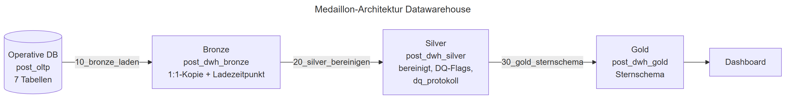
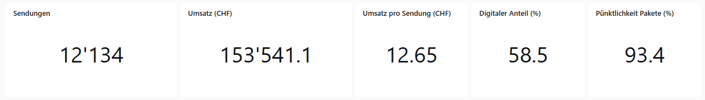
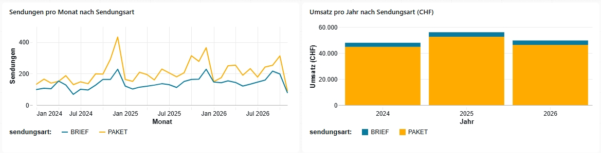
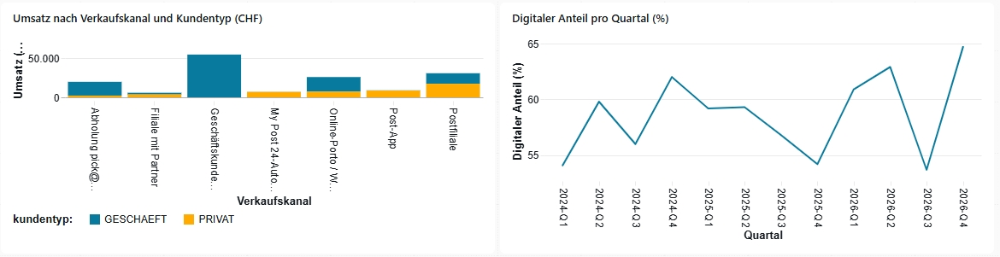
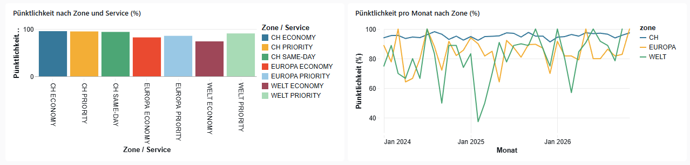

# Leistungsnachweis DB & DWH – Variante 1

**Operative Datenbank, Datawarehouse und Auswertung für den Brief- und Paketversand der Schweizer Post**

| Angabe | |
|---|---|
| Modul | Datenbanken & Datawarehouse (DB & DWH), ZHAW School of Engineering |
| Team | Dominik Erbsland, Joel Liechti |
| Abgabe | 30.11.2026 |
| Repository | <https://github.com/taar1/ZHAW_DB_DQH_Leistungsnachweis> |
| Werkzeuge | Databricks Free Edition (Serverless, Unity Catalog), Python, Mermaid, Databricks AI/BI Dashboard |

> **Hinweis zur Arbeit am Bericht:** Stellen mit **TODO** müssen wir noch ergänzen. Die Diagramme liegen als
> Mermaid-Quellen in `docs/diagramme/` und als Bilder in `bericht/bilder/`. Nach einer Änderung an einer
> `.mmd`-Datei das Bild neu erzeugen.

### Schnellstart: Projekt in Databricks nachvollziehen

So lassen sich die Ergebnisse beim Lesen direkt in Databricks anschauen:

1. **Notebooks holen**, eine der beiden Varianten:
   - Abgabedatei `post_leistungsnachweis.dbc` importieren: **Workspace** → eigener Ordner → **⋮ → Import**.
   - Oder als Git-Ordner verknüpfen: **Workspace → Create → Git folder**, URL
     `https://github.com/taar1/ZHAW_DB_DQH_Leistungsnachweis` (öffentlich, kein Token nötig).
2. **Operative Datenbank aufsetzen:** Notebook `sql/00_setup_alles` öffnen, Compute *Serverless*, **Run all**.
   Legt das Schema `post_oltp` an und füllt es (Kapitel 3–4).
3. **Datawarehouse laden:** Notebook `databricks/00_etl_alles` → **Run all**. Legt `post_dwh_bronze`,
   `post_dwh_silver` und `post_dwh_gold` an, inkl. der Sichten für das Dashboard (Kapitel 6–9).
4. **Anschauen:** Im **Catalog** unter `workspace` die vier Schemas öffnen, im **SQL Editor** z.B.
   `SELECT * FROM workspace.post_dwh_silver.dq_protokoll;`

Beide Notebooks laufen je 1–2 Minuten und können beliebig oft ausgeführt werden. Details und Kontrollwerte stehen in
[`INSTALL.md`](../INSTALL.md).

---

## Inhaltsverzeichnis

1. [Ausgangslage und Geschäftsanwendung](#1-ausgangslage-und-geschäftsanwendung) (Aufgabe 1)
2. [Entitäten-Relationen-Modell](#2-entitäten-relationen-modell) (Aufgabe 2)
3. [Umsetzung der operativen Datenbank in Databricks](#3-umsetzung-der-operativen-datenbank-in-databricks) (Aufgabe 3)
4. [Beispieldaten](#4-beispieldaten) (Aufgabe 4)
5. [Informationsbedarf und Steuerungskennzahlen](#5-informationsbedarf-und-steuerungskennzahlen) (Aufgabe 5)
6. [Multidimensionales Datenmodell](#6-multidimensionales-datenmodell) (Aufgabe 6)
7. [Datawarehouse in der Medaillon-Architektur](#7-datawarehouse-in-der-medaillon-architektur) (Aufgabe 7)
8. [Datenqualitätsprüfungen im ETL-Prozess](#8-datenqualitätsprüfungen-im-etl-prozess) (Aufgabe 8)
9. [Auswertungsdashboard](#9-auswertungsdashboard) (Aufgabe 9)
10. [Fazit und Reflexion](#10-fazit-und-reflexion)
11. [Anhang](#11-anhang)

---

## 1. Ausgangslage und Geschäftsanwendung

### 1.1 Beruflicher Kontext

Wir arbeiten beide bei der **Schweizerischen Post / PostAuto**. Die Post verkauft Privat- und Geschäftskunden den
Versand von Briefen und Paketen, im Inland und ins Ausland. Verkauft wird über physische Kanäle (Postfiliale, Filiale
mit Partner, My Post 24-Automat, Abholung pick@home) und über digitale Kanäle (Online-Porto/WebStamp, Post-App,
Geschäftskundenportal bzw. Versandschnittstelle). Pakete erhalten eine Sendungsnummer und können verfolgt werden,
normale Briefe nicht.

Wir bilden einen **vereinfachten Ausschnitt** dieses Geschäfts ab. Produkte und Preise lehnen sich an das Sortiment
der Post an. Alle Kunden- und Empfängerdaten sind erfunden.

### 1.2 Geschäftsanwendung „Versand“

Die Anwendung deckt diese Abläufe ab:

1. **Kunden:** Privat- und Geschäftskunden werden mit Name bzw. Firma, E-Mail und Adresse erfasst.
2. **Verkauf:** Ein Kunde kauft über einen **Verkaufskanal** eine oder mehrere Sendungen. Ein Kauf ist ein Auftrag.
3. **Sendungen:** Jede Position eines Auftrags ist eine **Sendung** mit genau einem **Produkt** (z.B. *Paket
   Priority M*) und einem **Empfänger**. Pakete erhalten eine Trackingnummer.
4. **Zustellung:** Zu jeder Sendung gibt es das Aufgabedatum und das versprochene Zustelldatum (Soll). Bei Paketen kommen aus dem Tracking das effektive Zustelldatum (Ist) und der Status dazu (unterwegs, zugestellt, retourniert, verloren). Bei Briefen bleiben diese Felder leer.

**Nicht** abgebildet sind die einzelnen Scans der Sendungsverfolgung, Zusatzleistungen wie Einschreiben und die
Standorte (Filialen, Sortierzentren). Für unsere Fragen (Kapitel 5) braucht es sie nicht.

Die geforderten Entitätstypen sind enthalten:

| Gefordert | Umsetzung im Modell |
|---|---|
| Kunde | `KUNDE` (Privat- und Geschäftskunden) |
| Produkt | `PRODUKT` (Briefe/Pakete, Inland/Europa/Welt, Service, Gewichts-/Formatklassen) |
| Verkaufskanal | `VERKAUFSKANAL` (7 physische und digitale Kanäle) |
| Beziehungen | Kunde erteilt Auftrag über Verkaufskanal. Der Auftrag umfasst Sendungen eines Produkts an einen Empfänger |

### 1.3 Produktsortiment (vereinfacht)

| Sendungsart | Zone | Services | Format- / Gewichtsklassen | Preis CHF |
|---|---|---|---|---|
| Brief | Inland (CH + FL) | A-Post (1 Werktag), B-Post (3 Werktage) | Standardbrief (B5, 100 g), Grossbrief (B4, 500 g), Maxibrief (B4, 1 kg) | 1.00 – 4.70 |
| Paket | Inland (CH + FL) | Economy (2 WT), Priority (1 WT), Same Day | S (bis 2 kg), M (bis 10 kg), L (bis 30 kg) | 9.00 – 49.00 |
| Brief | Europa | Priority, Economy | bis 20 g, bis 250 g, bis 2 kg | 2.20 – 18.00 |
| Brief | Welt | Priority, Economy | bis 20 g, bis 250 g, bis 2 kg | 2.50 – 32.00 |
| Paket | Europa | Priority, Economy | bis 2 kg, bis 10 kg, bis 30 kg | 31.00 – 115.00 |
| Paket | Welt | Priority, Economy | bis 2 kg, bis 10 kg, bis 30 kg | 42.00 – 230.00 |

Das ergibt **37 Produkte**. Liechtenstein gilt tariflich als Inland.

---

## 2. Entitäten-Relationen-Modell

### 2.1 ER-Diagramm

Quelle: [`docs/diagramme/erm_oltp.mmd`](../docs/diagramme/erm_oltp.mmd). Notation: Crow's Foot; `PK` = Primärschlüssel,
`FK` = Fremdschlüssel, `UK` = eindeutiger fachlicher Schlüssel.



**Legende der Linienenden (Crow's Foot):** Das Zeichen am Ende einer Linie gibt an, wie viele Datensätze auf dieser
Seite zu einem Datensatz der anderen Seite gehören.

| Zeichen am Linienende | Bedeutung | Beispiel |
|---|---|---|
| zwei Striche `‖` | genau eins (1) | ein Auftrag gehört zu genau einem Kunden |
| Kreis und Krähenfuss `○<` | keins, eins oder mehrere (0..n) | ein Kunde hat 0..n Aufträge |
| Strich und Krähenfuss `\|<` | eins oder mehrere (1..n) | ein Auftrag hat mindestens eine Sendung |

Die Beschriftung der Linie nennt die Beziehung (z.B. „erteilt“). Die ID-Beziehung zwischen Auftrag und Sendung ist
mit „(ID-Beziehung)“ markiert, siehe 2.4.

### 2.2 Entitätstypen

| Entitätstyp | Art | Bedeutung | Schlüssel |
|---|---|---|---|
| `LAND` | Stammdaten | Land mit Tarifzone (CH, EUROPA, WELT) | `land_code` (ISO 3166) |
| `KUNDE` | Stammdaten | Absender und Käufer, Privat- oder Geschäftskunde, inkl. Adresse | `kunde_id` |
| `VERKAUFSKANAL` | Stammdaten | Kanal des Verkaufs (physisch/digital) | `kanal_id` |
| `PRODUKT` | Stammdaten | Versandprodukt mit Zone, Service, Gewichtslimite, Soll-Laufzeit und Preis | `produkt_id` |
| `EMPFAENGER` | Stammdaten | Empfänger einer Sendung, inkl. Adresse | `empfaenger_id` |
| `AUFTRAG` | Bewegungsdaten | Kauf eines Kunden über einen Kanal | `auftrag_id` |
| `SENDUNG` | Beziehungstabelle, abhängig von `AUFTRAG` | Position eines Auftrags = eine Sendung | (`auftrag_id`, `position_nr`) |

Alle Tabellen ausser `SENDUNG` sind normale Entitätstabellen mit eigenem Schlüssel. **Stammdaten** ändern sich
selten (Kunden, Produkte, Länder), **Bewegungsdaten** entstehen laufend mit jedem Kauf.

`SENDUNG` ist die einzige **Beziehungstabelle**: Sie verbindet einen Auftrag mit einem Produkt und einem Empfänger.
Damit löst sie die m:n-Beziehung zwischen `AUFTRAG` und `PRODUKT` auf, denn ein Auftrag kann mehrere Produkte
enthalten und ein Produkt kommt in vielen Aufträgen vor. Zusätzlich hat sie eigene Attribute (Gewicht, Preis,
Daten, Status). Ihr Schlüssel hängt vom Auftrag ab (ID-Beziehung, siehe 2.4): Ohne Auftrag gibt es keine Sendung.

Die Adresse steht direkt in `KUNDE` bzw. `EMPFAENGER`. Eine eigene Adresstabelle wäre sauberer normalisiert, bringt
für unsere Auswertungen aber nichts.

`KUNDE` und `EMPFAENGER` sind getrennt, weil sie verschiedene Rollen haben: Der Kunde kauft und bezahlt, der
Empfänger ist nur die Zieladresse, oft im Ausland und ohne Beziehung zur Post.

Beim Empfänger sind `name`, `ort` und `land_code` Pflichtfelder (`NOT NULL`), denn ohne sie ist keine Zustellung
möglich und das Land bestimmt Zone und Preis. `strasse` und `plz` sind dagegen optional: Einige Länder kennen keine
Postleitzahl, in unseren Daten betrifft das die 14 Empfänger in den Vereinigten Arabischen Emiraten (`plz` = NULL).
Ebenso hätten Postfach- oder postlagernde Adressen keine Strasse. Das ERD zeigt Pflichtfelder nicht an; sie sind im
Schema (`sql/01_create_schema.sql`) definiert.

### 2.3 Beziehungen und Kardinalitäten

| Beziehung | Kardinalität | Erläuterung |
|---|---|---|
| Kunde – Auftrag | 1 : 0..n | Ein Kunde hat beliebig viele Aufträge, ein Auftrag gehört zu genau einem Kunden. |
| Verkaufskanal – Auftrag | 1 : 0..n | Jeder Auftrag läuft über genau einen Kanal. |
| Auftrag – Sendung | 1 : 1..n | **ID-Beziehung**, siehe 2.4. |
| Produkt – Sendung | 1 : 0..n | Jede Sendung ist genau ein Produkt. Daraus ergibt sich die **Kunde–Produkt-Beziehung** (m:n, aufgelöst über Auftrag und Sendung). |
| Empfänger – Sendung | 1 : 0..n | Ein Empfänger kann mehrere Sendungen erhalten. |
| Land – Kunde / Empfänger | 1 : 0..n | Die Zone des Empfängerlandes bestimmt, welche Produkte möglich sind. |

### 2.4 ID-Beziehung Auftrag → Sendung

Bei einer **ID-Beziehung** lässt sich eine Entität nur zusammen mit ihrer übergeordneten Entität eindeutig
identifizieren. Ihr Primärschlüssel enthält deshalb den Schlüssel der übergeordneten Entität.

- Eine Sendung gibt es nur innerhalb eines Auftrags: ohne Kauf keine Sendung.
- Sie wird über ihre **Positionsnummer im Auftrag** identifiziert: `PK(SENDUNG) = (auftrag_id, position_nr)`.
  `auftrag_id` ist dabei Teil des Primärschlüssels und gleichzeitig Fremdschlüssel auf `AUFTRAG`.
- Kardinalität 1 : 1..n, denn jeder Auftrag hat mindestens eine Sendung.

Beispiel aus den Daten: Auftrag 25 (Privatkunde, Postfiliale) mit fünf Sendungen:

| auftrag_id | position_nr | tracking_nr | Produkt | Empfänger (Land) |
|---:|---:|---|---|---|
| 25 | 1 | – | Standardbrief A-Post | CH |
| 25 | 2 | 99.34.100039.10000629 | Paket Economy M | CH |
| 25 | 3 | – | Standardbrief A-Post | CH |
| 25 | 4 | 99.60.100039.10000666 | Paket Priority M | CH |
| 25 | 5 | CP100001335CH | Paket International Welt Priority (bis 10 kg) | US |

`position_nr = 1` allein ist nicht eindeutig, denn jeder Auftrag hat eine Position 1. Erst zusammen mit `auftrag_id`
ist der Schlüssel eindeutig.

---

## 3. Umsetzung der operativen Datenbank in Databricks

Die operative Datenbank ist im Unity Catalog das Schema **`workspace.post_oltp`**
(DDL: [`sql/01_create_schema.sql`](../sql/01_create_schema.sql)). Alle 7 Tabellen sind **Delta-Tabellen**.

Wichtige Entscheide:

- **Datentypen:** Geldbeträge als `DECIMAL` (keine Rundungsfehler wie bei `DOUBLE`), Daten als `DATE`,
  Postleitzahlen als `STRING` (ausländische PLZ enthalten Buchstaben, z.B. „SW1A 1AA“).
- **Schlüssel:** `PRIMARY KEY` und `FOREIGN KEY` sind definiert. Databricks prüft sie aber nicht, sie dienen nur der
  Dokumentation und erscheinen im Catalog Explorer. Die referentielle Integrität prüfen wir deshalb selbst im ETL (Kapitel 8).
- **Geprüfte Regeln:** `NOT NULL` und `CHECK` prüft Databricks bei jedem Insert, z.B. `kundentyp IN
  ('PRIVAT','GESCHAEFT')`, `preis_chf >= 0` oder gültige Sendungsstatus.
- **Dokumentation:** Jede Tabelle und Spalte hat einen `COMMENT`.

Auszug aus der DDL:

```sql
CREATE TABLE post_oltp.sendung (
  auftrag_id           INT           NOT NULL COMMENT 'PK-Teil und FK auf auftrag (ID-Beziehung)',
  position_nr          INT           NOT NULL COMMENT 'PK-Teil: laufende Nummer der Sendung im Auftrag',
  tracking_nr          STRING                 COMMENT 'Sendungsnummer, nur bei Paketen (Briefe sind nicht verfolgbar)',
  produkt_id           INT           NOT NULL COMMENT 'FK auf produkt',
  empfaenger_id        INT           NOT NULL COMMENT 'FK auf empfaenger',
  ...
  CONSTRAINT pk_sendung PRIMARY KEY (auftrag_id, position_nr),
  CONSTRAINT fk_sendung_auftrag FOREIGN KEY (auftrag_id) REFERENCES post_oltp.auftrag (auftrag_id),
  ...
);
```

> **TODO:** Screenshot Catalog Explorer mit Schema `post_oltp` und den 7 Tabellen einfügen.

---

## 4. Beispieldaten

### 4.1 Vorgehen

Die Beispieldaten erzeugt ein Python-Skript ([`scripts/generate_data.py`](../scripts/generate_data.py)). Es schreibt
SQL-INSERT-Skripte, die `sql/00_setup_alles` in `post_oltp` lädt:

| Datei | Tabellen |
|---|---|
| `sql/02_insert_stammdaten.sql` | `land`, `verkaufskanal`, `produkt` |
| `sql/03_insert_kunden_empfaenger.sql` | `kunde`, `empfaenger` |
| `sql/04_insert_auftraege_sendungen.sql` | `auftrag`, `sendung` |

Die Skripte ersetzen den laufenden Betrieb, in der Praxis würden die Daten im Postsystem selbst entstehen. Für das
Datawarehouse ist `post_oltp` die Quelle (Kapitel 7).

Der Generator verwendet einen **festen Zufalls-Seed**, die Daten sind also bei jedem Lauf gleich. Damit die
Auswertungen realistisch aussehen, bildet er typische Muster nach:

- Kunden haben einen **bevorzugten Kanal**. Geschäftskunden bestellen vor allem digital, Privatkunden häufiger in der Filiale.
- **Saisonalität:** Spitzen im November (Black Friday) und Dezember, wenig Aufträge an Sonn- und Feiertagen.
  Briefe machen über den ganzen Zeitraum rund 40 % der Sendungen aus.
- Das **Produkt** passt zur Zone des Empfängers, das **Gewicht** zur Gewichtsklasse.
- Das **Soll-Zustelldatum** ergibt sich aus der Laufzeit des Produkts. Rund 6–7 % der Pakete sind verspätet, vor
  Weihnachten mehr. Dazu kommen wenige Retouren und verlorene Pakete.
- **Trackingnummern** gibt es nur für Pakete, im Aufbau der Post, z.B. `99.60.123456.12345678` (Inland) oder
  `CP100001335CH` (international).

Zeitraum: **01.01.2024 – 09.11.2026**, Datenstand 10.11.2026.

### 4.2 Datenmengen

| Tabelle | Zeilen |
|---|---:|
| land | 24 |
| verkaufskanal | 7 |
| produkt | 37 |
| kunde | 658 (528 privat, 130 geschäftlich) |
| empfaenger | 3'000 |
| auftrag | 5'687 |
| sendung | 12'134 |

### 4.3 Absichtlich eingebaute Datenfehler

Echte Systeme enthalten immer fehlerhafte Daten. Damit die Prüfungen im DWH (Kapitel 8) etwas finden, haben wir
folgende Fehler eingebaut:

| Nr. | Problem | Tabelle.Spalte | Anzahl | Typische Ursache in der Praxis |
|---|---|---|---:|---|
| 1 | E-Mail fehlt oder ungültig | `kunde.email` | 20 | Freitexterfassung am Schalter |
| 2 | Ungültige Schweizer PLZ (nicht 4-stellig) | `kunde.plz` | 6 | Tippfehler, „CH-8001“ |
| 3 | Ort unterschiedlich geschrieben (Zuerich, ZÜRICH, Genf) | `kunde.ort` | 10 | Mehrsprachigkeit, keine Vorgaben |
| 4 | Kunde doppelt erfasst | `kunde` | 8 | Neu registriert statt eingeloggt |
| 5 | Gewicht grösser als Produktlimite | `sendung.gewicht_g` | 109 | Falsches Produkt gewählt, Waage |
| 6 | Gewicht fehlt oder 0 | `sendung.gewicht_g` | 44 | Nicht gewogen |
| 7 | Zustelldatum vor Aufgabedatum (Pakete) | `sendung.zustell_datum` | 7 | Falsche Uhrzeit eines Scanners |
| 8 | Empfänger existiert nicht | `sendung.empfaenger_id` | 12 | FK nicht geprüft, Empfänger gelöscht |
| 9 | Auftragstotal ≠ Summe der Sendungspreise | `auftrag.betrag_total_chf` | 43 | Manuelle Korrektur, Rundung |

Die Abfragen dazu stehen in [`sql/05_pruefabfragen.sql`](../sql/05_pruefabfragen.sql). Die Dublettenprüfung über Name und Strasse findet 9 Fälle: die 8 eingebauten und ein zufällig entstandenes Paar.

---

## 5. Informationsbedarf und Steuerungskennzahlen

### 5.1 Wer braucht welche Informationen?

| Rolle | Informationsbedarf |
|---|---|
| Geschäftsleitung | Entwicklung von Menge und Umsatz, Verhältnis Brief zu Paket |
| Vertrieb | Umsatz pro Verkaufskanal und Kundentyp, Nutzung der digitalen Kanäle |
| Betrieb / Qualitätsmanagement | Pünktlichkeit der Paketzustellung |

### 5.2 Kennzahlen (KPIs)

| KPI | Definition |
|---|---|
| Sendungsmenge | Anzahl Sendungen |
| Umsatz CHF | Summe `preis_chf` der Sendungen |
| Ø Umsatz pro Sendung | Umsatz / Sendungsmenge |
| Digitaler Anteil | Anteil des Umsatzes über digitale Kanäle |
| Pünktlichkeitsquote | Anteil zugestellter Pakete mit `zustell_datum ≤ soll_zustell_datum` (nur Pakete, Briefe werden nicht verfolgt) |

Alle Kennzahlen lassen sich nach Zeit (Jahr, Quartal, Monat), Produkt, Kanal, Kunde und Zielland auswerten.

### 5.3 Fragestellungen

Diese drei Fragen beantwortet das Dashboard (Kapitel 9):

- **F1 – Brief vs. Paket:** Wie entwickeln sich Menge und Umsatz von Briefen und Paketen von Monat zu Monat? Welche Saisonalität gibt es?
- **F2 – Verkaufskanäle:** Wie viel Umsatz bringt welcher Kanal und Kundentyp, und wächst der digitale Anteil?
- **F3 – Pünktlichkeit:** Wie pünktlich sind die Pakete pro Zone und Service (Priority, Economy, Same Day)? Sinkt die Pünktlichkeit vor Weihnachten? Für Briefe lässt sich das mit unseren Daten nicht beantworten, weil sie kein Tracking haben. 

---

## 6. Multidimensionales Datenmodell

### 6.1 Geschäftsobjekt

Wir wählen die **Sendung** als Geschäftsobjekt. Damit lassen sich alle Fragen aus Kapitel 5 beantworten: Menge,
Umsatz und bei Paketen die Pünktlichkeit.

**Granularität:** Eine Zeile der Faktentabelle ist **eine Sendung**. Feiner geht es nicht, und daraus lässt sich
jede gröbere Sicht (Monat, Kanal, Zone …) zusammenzählen.

### 6.2 Sternschema

Quelle: [`docs/diagramme/sternschema_sendung.mmd`](../docs/diagramme/sternschema_sendung.mmd)



Die Linienenden sind gleich zu lesen wie im ER-Diagramm (Legende in 2.1): Jede Dimensionszeile gehört zu 0..n
Fakten, jede Faktenzeile zu genau einer Zeile pro Dimension.

Die **Faktentabelle** `fact_sendung` enthält die Kennzahlen und die Schlüssel auf die Dimensionen. Die
**Dimensionen** beschreiben den Zusammenhang einer Sendung: wann (Datum), wer (Kunde), was (Produkt), wie
gekauft (Kanal) und wohin (Zielland).

### 6.3 Dimensionen und Hierarchien

| Dimension | Hierarchie (grob → fein) | Quelle in `post_oltp` |
|---|---|---|
| `dim_datum` (Aufgabedatum) | Jahr → Quartal → Monat → Tag | generiert (Kalender) |
| `dim_kunde` | Kundentyp → Kunde | `kunde` |
| `dim_produkt` | Sendungsart → Zone → Service → Produkt | `produkt` |
| `dim_kanal` | Kanaltyp (physisch/digital) → Kanal | `verkaufskanal` |
| `dim_zielland` | Zone → Land | `land` (über `empfaenger`) |

### 6.4 Kennzahlen in der Faktentabelle

| Kennzahl | Summierbar? | Bemerkung |
|---|---|---|
| `anzahl_sendungen` | ja | immer 1, vereinfacht das Zählen |
| `umsatz_chf` | ja | |
| `gewicht_g` | ja | leer, wenn das Gewicht unplausibel ist (Kapitel 8) |
| `laufzeit_werktage` | nein | nur der Durchschnitt ist sinnvoll |
| `puenktlich_flag` | nein | 1 = pünktlich, 0 = verspätet, leer = nicht zugestellt oder Brief; der Durchschnitt ergibt die Pünktlichkeitsquote |

**Entscheide**

- **Schlüssel:** Die Dimensionen übernehmen die IDs aus der operativen DB (`kunde_id`, `produkt_id` …), das Datum hat den Schlüssel `YYYYMMDD`. Da wir keine Historie führen (SCD Typ 1: Änderungen überschreiben den alten Wert), braucht es keine zusätzlichen Schlüssel.
- `tracking_nr` und `status` stehen direkt in der Faktentabelle (*degenerierte Dimensionen*). Für zwei Spalten lohnt
  sich keine eigene Dimension. Bei Briefen sind beide leer.
- **Unbekannte Werte:** Sendungen ohne gültigen Empfänger (Datenfehler, siehe Kapitel 8) bekommen das Zielland `XX – Unbekannt`, damit ihr Umsatz nicht verloren geht.

---

## 7. Datawarehouse in der Medaillon-Architektur

Quelle: [`docs/diagramme/medaillon_architektur.mmd`](../docs/diagramme/medaillon_architektur.mmd)



| Schicht | Schema | Inhalt | ETL-Notebook |
|---|---|---|---|
| Bronze | `post_dwh_bronze` | Unveränderte Kopie der 7 Tabellen aus `post_oltp`, plus Ladezeitpunkt `_geladen_am` | `10_bronze_laden` |
| Silver | `post_dwh_silver` | Bereinigte Daten, jede Sendung mit Markierungen aus den Prüfungen, dazu das Prüfprotokoll `dq_protokoll` | `20_silver_bereinigen` |
| Gold | `post_dwh_gold` | Sternschema (Kapitel 6) für das Dashboard | `30_gold_sternschema` |

Die Schichten entsprechen der DWH-Referenzarchitektur aus dem Unterricht (DWH-3, Folien 25–29): Bronze ist die
Staging Area, Silver die Integration, Gold die Data Marts für die Analyse.

Bei jedem Lauf werden alle Schichten komplett neu geladen (*Full Load* mit `CREATE OR REPLACE TABLE … AS SELECT`).
Bei unserer Datenmenge ist das am einfachsten. Im Betrieb würde man nur die Änderungen laden (inkrementell).

Die Notebooks liegen im Ordner [`databricks/`](../databricks), `00_etl_alles` führt sie der Reihe nach aus:

- **`10_bronze_laden`** kopiert jede Tabelle unverändert nach Bronze und vergleicht danach die Zeilenzahlen mit der Quelle.
- **`20_silver_bereinigen`** vereinheitlicht Ortsnamen und E-Mail-Adressen, führt die vier Datenqualitätsprüfungen aus (Kapitel 8), markiert fehlerhafte Datensätze und schreibt das Prüfprotokoll.
- **`30_gold_sternschema`** erzeugt `dim_datum` als Kalender (ein Eintrag pro Tag 2024–2026), übernimmt die übrigen Dimensionen aus Silver und baut `fact_sendung`. Dabei werden Laufzeit und Pünktlichkeit berechnet. Eine Kontrollabfrage prüft, dass jede Sendung genau einmal vorkommt und jeder Schlüssel eine Dimension findet.
- **`40_dashboard_views`** legt pro Frage eine Sicht für das Dashboard an (Kapitel 9).

Auszug aus `30_gold_sternschema` (Berechnung der Pünktlichkeit):

```sql
CASE
  WHEN s.status = 'ZUGESTELLT' AND s.zustell_datum IS NOT NULL
    THEN CASE WHEN s.zustell_datum <= s.soll_zustell_datum THEN 1 ELSE 0 END
END AS puenktlich_flag
```

> **TODO (Team):** Screenshot der Schemas `post_dwh_bronze`, `post_dwh_silver` und `post_dwh_gold` im Catalog
> Explorer einfügen.

---

## 8. Datenqualitätsprüfungen im ETL-Prozess

Die Prüfungen laufen beim Laden von Silver (Notebook `20_silver_bereinigen`). Verlangt sind mindestens zwei, wir
haben vier umgesetzt:

| Prüfung | Regel | Was passiert mit fehlerhaften Daten |
|---|---|---|
| **Empfänger vorhanden** | Jede `sendung.empfaenger_id` existiert in `empfaenger` | Sendung bleibt, Zielland = „Unbekannt“ |
| **Gewicht plausibel** | `gewicht_g > 0` und `≤ produkt.max_gewicht_g` | Gewicht wird leer gesetzt, Umsatz zählt weiter |
| **Datum plausibel** | `zustell_datum ≥ aufgabe_datum` | Laufzeit und Pünktlichkeit bleiben leer, zählen nicht zur Quote |
| **Auftragstotal stimmt** | `auftrag.betrag_total_chf = Summe sendung.preis_chf` | Abweichung wird protokolliert, im DWH gilt die Summe der Sendungen |

Fehlerhafte Datensätze werden nicht gelöscht, sondern markiert. Der ursprüngliche Wert bleibt in Bronze erhalten,
bei Gewicht, Ort und Auftragstotal zusätzlich in einer eigenen Spalte in Silver. Zusätzlich werden Ortsnamen vereinheitlicht (z.B. „Zuerich“ → „Zürich“) und E-Mail-Adressen klein und ohne
Leerzeichen gespeichert.

Jede Prüfung schreibt pro Lauf eine Zeile in das Prüfprotokoll `post_dwh_silver.dq_protokoll` (dq = Datenqualität). Die Tabelle wird nicht überschrieben,
so sieht man die Entwicklung über mehrere Läufe. Im Protokoll sind die vier Prüfungen mit P1 bis P4 nummeriert
(in der Reihenfolge der Tabelle oben). Ergebnis eines Laufs:

| Prüfung | Tabelle | geprüft | fehlerhaft | Anteil |
|---|---|---:|---:|---:|
| Empfänger vorhanden | sendung | 12'134 | 12 | 0.10 % |
| Gewicht plausibel | sendung | 12'134 | 153 | 1.26 % |
| Datum plausibel | sendung | 12'134 | 7 | 0.06 % |
| Auftragstotal stimmt | auftrag | 5'687 | 43 | 0.76 % |
| Info: Ort vereinheitlicht | kunde | 658 | 10 | 1.52 % |
| Info: E-Mail fehlt oder ungültig | kunde | 658 | 20 | 3.04 % |

Die Prüfungen finden genau die Fehler aus Kapitel 4.3 (beim Gewicht: 109 zu schwere + 44 fehlende Gewichte = 153).

> **TODO (Team):** Screenshot des Prüfprotokolls (`dq_protokoll`) nach dem Lauf einfügen.

---

## 9. Auswertungsdashboard

Das Dashboard ist ein **Databricks AI/BI Dashboard** und liest nur aus dem Gold-Layer. Für jede Frage gibt es eine
Sicht in `post_dwh_gold` (Notebook `40_dashboard_views`). So liegen die Abfragen versioniert im Repository.

| Frage | Sicht | Darstellung |
|---|---|---|
| Kennzahlen | `v_kpi_uebersicht` | Kacheln: Sendungen, Umsatz, Ø Umsatz/Sendung, digitaler Anteil, Pünktlichkeit |
| F1 Brief vs. Paket | `v_f1_brief_paket_monat` | Linie: Sendungen pro Monat; Balken: Umsatz pro Jahr |
| F2 Verkaufskanäle | `v_f2_umsatz_kanal`, `v_f2_digital_quartal` | Balken: Umsatz pro Kanal und Kundentyp; Linie: digitaler Anteil pro Quartal |
| F3 Pünktlichkeit (Pakete) | `v_f3_puenktlichkeit_service`, `v_f3_puenktlichkeit_monat` | Balken: Quote pro Zone und Service; Linie: Quote pro Monat und Zone |

Die Daten reichen bis zum 09.11.2026. November 2026 und das 4. Quartal 2026 sind deshalb unvollständig.

### 9.1 Kennzahlen



Insgesamt wurden 12'134 Sendungen für 153'541 CHF verkauft, im Schnitt 12.65 CHF pro Sendung. 58.5 % des Umsatzes
laufen über digitale Kanäle, 93.4 % der zugestellten Pakete kommen pünktlich an.

### 9.2 F1 – Brief vs. Paket



Pakete machen rund 60 % der Sendungen, aber über 90 % des Umsatzes aus. Ein Brief bringt im Schnitt rund 2 CHF, ein
Paket knapp 20 CHF. Der Briefanteil bleibt über die drei Jahre stabil bei rund 40 %. Beide Sendungsarten haben
Spitzen im November (Black Friday) und Dezember (Weihnachten), Pakete deutlich stärker: Im Dezember 2024 waren es 433
Pakete, im Juni 2025 nur 229. Der Einbruch ganz rechts ist kein echter Rückgang, sondern der unvollständige
November 2026.

### 9.3 F2 – Verkaufskanäle



Der wichtigste Kanal ist das Geschäftskundenportal bzw. die Versandschnittstelle mit rund 36 % des Umsatzes, fast
nur von Geschäftskunden. Geschäftskunden nutzen auch WebStamp und pick@home stark. Privatkunden kaufen vor allem in
der Postfiliale, danach in der Post-App und am My Post 24-Automaten. Der digitale Anteil schwankt pro Quartal
zwischen 54 % und 65 %, einen klaren Trend gibt es nicht. Die Schwankungen kommen daher, dass wenige grosse
Geschäftskunden mit vielen Sendungen den Umsatz prägen. Der Höchstwert im 4. Quartal 2026 sagt wenig aus, weil das
Quartal erst bis zum 9. November erfasst ist.

### 9.4 F3 – Pünktlichkeit der Pakete



Im Inland kommen 94–96 % der Pakete pünktlich an, im Ausland deutlich weniger: Europa 82–86 %, Welt 74 % (Economy)
bis 91 % (Priority). International ist Economy klar weniger pünktlich als Priority. Im Dezember sinkt die
Pünktlichkeit überall, im Inland von 95.5 % auf 91.9 %, in die Zone Welt von 82.6 % auf 74.4 %. Der
Weihnachtseffekt ist also sichtbar. Die starken Ausschläge bei Europa und Welt pro Monat kommen von der kleinen
Anzahl Auslandpakete (oft unter 30 pro Monat), einzelne Verspätungen fallen da stark ins Gewicht.

---

## 10. Fazit und Reflexion

> **TODO (Dominik, Joel):** Fazit und Reflexion schreiben wir selbst.

---

## 11. Anhang

### 11.1 Dateien der Abgabe

| Datei / Ordner | Inhalt |
|---|---|
| `bericht.pdf` | Dieser Bericht |
| `post_leistungsnachweis.dbc` | Databricks-Export: SQL-Notebooks (`sql/`) und ETL-Notebooks (`databricks/`) |
| `INSTALL.md` | Installationsanleitung |
| `docs/diagramme/*.mmd` | Mermaid-Quellen der Diagramme (Bilder in `bericht/bilder/`) |
| `sql/02_…` bis `sql/04_…` | Beispieldaten als INSERT-Skripte (generiert) |
| `scripts/generate_data.py` | Datengenerator |

### 11.2 Installationsanleitung

Siehe [`INSTALL.md`](../INSTALL.md). Die Kurzfassung steht am Anfang des Berichts (Schnellstart).

### 11.3 Verwendung von KI-Werkzeugen

Wir haben den KI-Assistenten **Claude** (Anthropic) eingesetzt für:

- das SQL-Schema der operativen Datenbank (`sql/01_create_schema.sql`),
- die Testdaten (Datengenerator `scripts/generate_data.py` und die erzeugten INSERT-Skripte),
- die ETL-Notebooks und die Dashboard-Sichten (`databricks/`),
- die Diagramme aus den Mermaid-Quellen sowie Entwürfe für Textteile des Berichts.

Das Dashboard haben wir mit **Databricks Genie** aus einer Beschreibung erzeugt und danach von Hand angepasst (z.B.
ein falsch eingestelltes Liniendiagramm korrigiert).

Szenario, Entitäten, Fragestellungen und Umfang haben wir vorgegeben. Die Resultate haben wir geprüft: Wir haben alle Skripte und Notebooks in Databricks ausgeführt, die Daten mit den Prüfabfragen (`sql/05_pruefabfragen.sql`) und den Kontrollabfragen der ETL-Notebooks kontrolliert und die Zahlen im Dashboard damit verglichen. Fachliche Korrekturen haben wir selbst eingebracht, z.B. dass normale Briefe keine Sendungsnummer haben.
