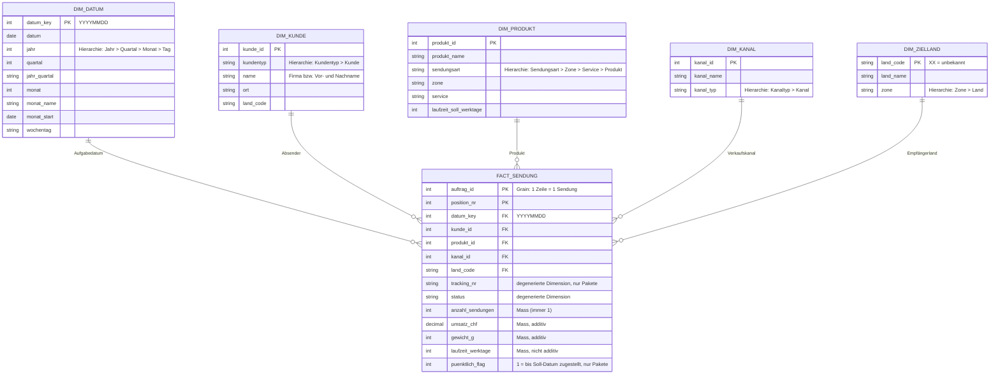
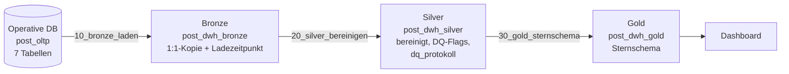

# Leistungsnachweis DB & DWH – Variante 1

**Operative Datenbank, Datawarehouse und Auswertung für den Brief- und Paketversand der Schweizer Post**

| Angabe | |
|---|---|
| Modul | Datenbanken & Datawarehouse (DB & DWH), ZHAW School of Engineering |
| Team | Dominik Erbsland, Joel Liechti |
| Abgabe | 30.11.2026 |
| Repository | <https://github.com/taar1/ZHAW_DB_DQH_Leistungsnachweis> |
| Werkzeuge | Databricks Free Edition (Serverless, Unity Catalog), Python, Mermaid, Databricks AI/BI Dashboard |

> **Hinweis zur Arbeit am Bericht:** Stellen mit **TODO** müssen wir noch ergänzen (Screenshots, Resultate aus
> Databricks, Interpretation). Die Diagramme liegen als Mermaid-Quellen in `docs/diagramme/` und sind hier
> eingebettet. Bei Änderungen beide Stellen nachführen.

### Schnellstart: Projekt in Databricks nachvollziehen

Damit die Ergebnisse beim Lesen direkt in Databricks angeschaut werden können:

1. **Notebooks holen**, eine der beiden Varianten:
   - Abgabedatei `post_leistungsnachweis.dbc` importieren: **Workspace** → eigener Ordner → **⋮ → Import**.
   - Oder als Git-Ordner verknüpfen: **Workspace → Create → Git folder**, URL
     `https://github.com/taar1/ZHAW_DB_DQH_Leistungsnachweis` (öffentlich, kein Token nötig).
2. **Operative Datenbank aufsetzen:** Notebook `sql/00_setup_alles` öffnen, Compute *Serverless*, **Run all**.
   Legt das Schema `post_oltp` (Kapitel 3–4) an und füllt es.
3. **Datawarehouse laden:** Notebook `databricks/00_etl_alles` → **Run all**. Legt `post_dwh_bronze`,
   `post_dwh_silver` und `post_dwh_gold` an (Kapitel 6–8) inkl. der Sichten für das Dashboard (Kapitel 9).
4. **Anschauen:** Im **Catalog** unter `workspace` die vier Schemas öffnen, im **SQL Editor** z.B.
   `SELECT * FROM workspace.post_dwh_silver.dq_protokoll;`

Beide Notebooks dauern je 1–2 Minuten und können beliebig oft ausgeführt werden. Details und Kontrollwerte:
[`INSTALL.md`](../INSTALL.md).

---

## Inhaltsverzeichnis

1. [Ausgangslage und Geschäftsanwendung](#1-ausgangslage-und-geschäftsanwendung) (Aufgabe 1)
2. [Entitäten-Relationen-Modell](#2-entitäten-relationen-modell) (Aufgabe 2)
3. [Umsetzung der operativen Datenbank in Databricks](#3-umsetzung-der-operativen-datenbank-in-databricks) (Aufgabe 3)
4. [Beispieldaten](#4-beispieldaten) (Aufgabe 4)
5. [Informationsbedarf und Steuerungskennzahlen](#5-informationsbedarf-und-steuerungskennzahlen) (Aufgabe 5)
6. [Multidimensionales Datenmodell](#6-multidimensionales-datenmodell) (Aufgabe 6)
7. [Datawarehouse in der Medaillon-Architektur](#7-datawarehouse-in-der-medaillon-architektur) (Aufgabe 7)
8. [Datenqualitätsprüfungen im ETL-Prozess](#8-datenqualitätsprüfungen-im-etl-prozess) (Aufgabe 8)
9. [Auswertungsdashboard](#9-auswertungsdashboard) (Aufgabe 9)
10. [Fazit und Reflexion](#10-fazit-und-reflexion)
11. [Anhang](#11-anhang)

---

## 1. Ausgangslage und Geschäftsanwendung

### 1.1 Beruflicher Kontext

Wir arbeiten beide bei der **Schweizerischen Post / PostAuto**. Die Post verkauft Privat- und Geschäftskunden Versandleistungen
für Briefe und Pakete, im Inland wie ins Ausland. Verkauft wird über physische Kanäle (Postfilialen,
Filialen mit Partner, My Post 24-Automaten, Abholung pick@home) und über digitale Kanäle (Online-Porto/WebStamp,
Post-App, Geschäftskundenportal bzw. Versandschnittstelle). Pakete erhalten eine Sendungsnummer (Trackingnummer)
und können verfolgt werden. Normale Briefe (A-Post, B-Post, international) haben keine Sendungsnummer.

Für den Leistungsnachweis modellieren wir einen **vereinfachten Ausschnitt** dieses Geschäfts. Produkte und Preise
sind an das öffentliche Sortiment der Post angelehnt, aber vereinfacht. Alle Kunden- und Empfängerdaten sind
frei erfunden (synthetisch generiert).

### 1.2 Beschreibung der Geschäftsanwendung „Versand“

Die operative Anwendung unterstützt folgende Geschäftsprozesse:

1. **Kundenverwaltung:** Privatkunden und Geschäftskunden werden mit Name bzw. Firma, E-Mail und Adresse erfasst.
2. **Verkauf (Auftrag):** Ein Kunde kauft über einen **Verkaufskanal** eine oder mehrere Versandleistungen. Ein Kauf
   ist ein *Auftrag*.
3. **Sendungserfassung:** Jede Position des Auftrags ist eine **Sendung**. Sie verweist auf genau ein **Produkt**
   (z.B. *Paket Priority M*) und einen **Empfänger**. Pakete erhalten eine eindeutige Trackingnummer.
4. **Zustellung:** Für jede Sendung werden das Aufgabedatum und das gemäss Produktlaufzeit versprochene Zustelldatum
   (Soll) geführt. Bei Paketen liefert das Tracking zusätzlich das effektive Zustelldatum (Ist) und den Status
   (unterwegs, zugestellt, retourniert, verloren). Bei Briefen bleiben diese Felder leer, da sie nicht verfolgt
   werden.

Bewusst **nicht** modelliert haben wir die einzelnen Ereignisse der Sendungsverfolgung (Scans in Sortierzentren),
Zusatzleistungen wie Einschreiben sowie die Standorte (Filialen, Sortierzentren). Sie würden das Modell deutlich
vergrössern, ohne für unsere Fragestellungen (Kapitel 5) nötig zu sein.

Die von der Aufgabenstellung geforderten Entitätstypen sind abgedeckt:

| Gefordert | Umsetzung im Modell |
|---|---|
| Kunde | `KUNDE` (Privat- und Geschäftskunden) |
| Produkt | `PRODUKT` (Briefe/Pakete, Inland/Europa/Welt, Service, Gewichts-/Formatklassen) |
| Verkaufskanal | `VERKAUFSKANAL` (7 physische und digitale Kanäle) |
| Beziehungen | Kunde *erteilt* Auftrag *über* Verkaufskanal; Auftrag *umfasst* Sendungen eines Produkts an einen Empfänger |

### 1.3 Produktsortiment (vereinfacht)

| Sendungsart | Zone | Services | Format- bzw. Gewichtsklassen | Preisbereich CHF |
|---|---|---|---|---|
| Brief | Inland (CH + FL) | A-Post (1 Werktag), B-Post (3 Werktage) | Standardbrief (B5, 100 g), Grossbrief (B4, 500 g), Maxibrief (B4, 1 kg) | 1.00 – 4.70 |
| Paket | Inland (CH + FL) | Economy (2 WT), Priority (1 WT), Same Day | S (bis 2 kg), M (bis 10 kg), L (bis 30 kg) | 9.00 – 49.00 |
| Brief | Europa | Priority, Economy | bis 20 g, bis 250 g, bis 2 kg | 2.20 – 18.00 |
| Brief | Welt | Priority, Economy | bis 20 g, bis 250 g, bis 2 kg | 2.50 – 32.00 |
| Paket | Europa | Priority, Economy | bis 2 kg, bis 10 kg, bis 30 kg | 31.00 – 115.00 |
| Paket | Welt | Priority, Economy | bis 2 kg, bis 10 kg, bis 30 kg | 42.00 – 230.00 |

Insgesamt sind es **37 Produkte**. Liechtenstein gehört tariflich zum Inland.

---

## 2. Entitäten-Relationen-Modell

### 2.1 ER-Diagramm

Quelle: [`docs/diagramme/erm_oltp.mmd`](../docs/diagramme/erm_oltp.mmd). Notation: Crow's Foot; `PK` = Primärschlüssel,
`FK` = Fremdschlüssel, `UK` = alternativer (fachlicher) Schlüssel.


> **TODO:** Für das PDF das Diagramm als Bild exportieren (z.B. mermaid.live → PNG) und hier einfügen.
> Ergänzend kann man einen Screenshot des ER-Diagramms aus dem Databricks *Catalog Explorer*
> (Schema `post_oltp` → Tabelle → *Relationships*) einfügen.

### 2.2 Entitätstypen

| Entitätstyp | Bedeutung | Schlüssel |
|---|---|---|
| `LAND` | Land mit Tarifzone (CH, EUROPA, WELT) | `land_code` (ISO 3166) |
| `KUNDE` | Absender/Käufer; Privat- oder Geschäftskunde, inkl. Adresse | `kunde_id` |
| `VERKAUFSKANAL` | Kanal des Verkaufs (physisch/digital) | `kanal_id` |
| `PRODUKT` | Versandprodukt mit Zone, Service, Gewichtslimite, Soll-Laufzeit und Preis | `produkt_id` |
| `EMPFAENGER` | Empfänger einer Sendung, inkl. Adresse | `empfaenger_id` |
| `AUFTRAG` | Kaufvorgang eines Kunden über einen Kanal | `auftrag_id` |
| `SENDUNG` | Position eines Auftrags = eine physische Sendung | (`auftrag_id`, `position_nr`) |

Die Adresse ist direkt in `KUNDE` bzw. `EMPFAENGER` gespeichert. Eine eigene Adresstabelle wäre normalisierter,
bringt für unsere Auswertungen aber keinen Mehrwert.

`KUNDE` und `EMPFAENGER` sind bewusst getrennt: Der Kunde kauft und bezahlt (Kundenbeziehung), der Empfänger
ist nur die Zieladresse einer Sendung, oft im Ausland und ohne Beziehung zur Post. Ist eine Person beides, ist
das ein Rollenwechsel und wird nicht verknüpft.

### 2.3 Beziehungen und Kardinalitäten

| Beziehung | Kardinalität | Erläuterung |
|---|---|---|
| Kunde – Auftrag | 1 : 0..n | Ein Kunde kann beliebig viele Aufträge erteilen; jeder Auftrag gehört zu genau einem Kunden. |
| Verkaufskanal – Auftrag | 1 : 0..n | Jeder Auftrag wird über genau einen Kanal abgewickelt. |
| Auftrag – Sendung | 1 : 1..n | **ID-Beziehung**, siehe 2.4. |
| Produkt – Sendung | 1 : 0..n | Jede Sendung ist genau ein Produkt. Daraus ergibt sich die geforderte **Kunde–Produkt-Beziehung** (m:n, aufgelöst über Auftrag und Sendung). |
| Empfänger – Sendung | 1 : 0..n | Ein Empfänger kann mehrere Sendungen erhalten. |
| Land – Kunde / Empfänger | 1 : 0..n | Die Zone des Empfängerlandes bestimmt, welche Produkte zulässig sind. |

### 2.4 Detaillierte ID-Beziehung: Auftrag → Sendung

Eine **ID-Beziehung** (identifizierende Beziehung) liegt vor, wenn eine *schwache Entität* ohne die übergeordnete
Entität nicht eindeutig identifiziert werden kann. Ihr Primärschlüssel enthält deshalb den Primärschlüssel der
übergeordneten Entität.

- Eine Sendung existiert nur im Rahmen eines Auftrags (*Existenzabhängigkeit*): ohne Kauf keine Sendung.
- Die Sendung wird über die laufende **Positionsnummer innerhalb des Auftrags** identifiziert:
  `PK(SENDUNG) = (auftrag_id, position_nr)`. `auftrag_id` ist gleichzeitig Teil des Primärschlüssels und
  Fremdschlüssel auf `AUFTRAG`.
- Kardinalität 1 : 1..n, denn jeder Auftrag hat mindestens eine Sendung.
- Wird ein Auftrag storniert, fallen auch alle seine Sendungen weg (kaskadierendes Löschen ist fachlich korrekt).

Beispiel aus den Daten: Auftrag 25 (Privatkunde, gekauft in der Postfiliale) umfasst fünf Sendungen:

| auftrag_id | position_nr | tracking_nr | Produkt | Empfänger (Land) |
|---:|---:|---|---|---|
| 25 | 1 | – | Standardbrief A-Post | CH |
| 25 | 2 | 99.34.100039.10000629 | Paket Economy M | CH |
| 25 | 3 | – | Standardbrief A-Post | CH |
| 25 | 4 | 99.60.100039.10000666 | Paket Priority M | CH |
| 25 | 5 | CP100001335CH | Paket International Welt Priority (bis 10 kg) | US |

`position_nr = 1` ist für sich allein nicht eindeutig (jeder Auftrag hat eine Position 1), erst zusammen mit
`auftrag_id`.

**Warum nicht die `tracking_nr` als Schlüssel?** Sie ist zwar eindeutig, aber nur Pakete haben eine. Briefe haben
keine Sendungsnummer (im Beispiel Positionen 1 und 3), die Spalte ist deshalb optional und kann kein Primärschlüssel
sein. Die ID-Beziehung identifiziert dagegen jede Sendung und bildet die fachliche Abhängigkeit vom Auftrag ab.

---

## 3. Umsetzung der operativen Datenbank in Databricks

Die operative Datenbank ist im Unity Catalog als Schema **`workspace.post_oltp`** umgesetzt
(DDL: [`sql/01_create_schema.sql`](../sql/01_create_schema.sql)). Alle 7 Tabellen sind **Delta-Tabellen**.

Umsetzungsentscheide:

- **Datentypen:** Geldbeträge `DECIMAL` (keine Rundungsfehler wie bei `DOUBLE`), Daten `DATE`,
  Postleitzahlen `STRING` (ausländische PLZ enthalten Buchstaben/Leerzeichen, z.B. „SW1A 1AA“).
- **Schlüssel:** `PRIMARY KEY`- und `FOREIGN KEY`-Constraints sind deklariert. In Databricks sind sie
  **informativ** und werden nicht erzwungen. Sie dokumentieren das Modell, werden vom Optimizer genutzt und erscheinen
  im Catalog Explorer. Die referentielle Integrität prüfen wir deshalb selbst im ETL (siehe Kapitel 8).
- **Erzwungene Regeln:** `NOT NULL` und `CHECK`-Constraints (z.B. `kundentyp IN ('PRIVAT','GESCHAEFT')`,
  `preis_chf >= 0`, gültige Sendungsstatus) werden von Delta Lake bei jedem Insert geprüft.
- **Dokumentation im Katalog:** Jede Tabelle und Spalte hat einen `COMMENT`.

Auszug aus der DDL:

```sql
CREATE TABLE post_oltp.sendung (
  auftrag_id           INT           NOT NULL COMMENT 'PK-Teil und FK auf auftrag (ID-Beziehung)',
  position_nr          INT           NOT NULL COMMENT 'PK-Teil: laufende Nummer der Sendung im Auftrag',
  tracking_nr          STRING                 COMMENT 'Sendungsnummer, nur bei Paketen (Briefe sind nicht verfolgbar)',
  produkt_id           INT           NOT NULL COMMENT 'FK auf produkt',
  empfaenger_id        INT           NOT NULL COMMENT 'FK auf empfaenger',
  ...
  CONSTRAINT pk_sendung PRIMARY KEY (auftrag_id, position_nr),
  CONSTRAINT fk_sendung_auftrag FOREIGN KEY (auftrag_id) REFERENCES post_oltp.auftrag (auftrag_id),
  ...
);
```

> **TODO:** Screenshot Catalog Explorer mit Schema `post_oltp` und den 7 Tabellen einfügen.

---

## 4. Beispieldaten

### 4.1 Vorgehen

Die Beispieldaten erzeugt ein Python-Skript ([`scripts/generate_data.py`](../scripts/generate_data.py)). Es
schreibt die Daten als SQL-INSERT-Skripte, die `sql/00_setup_alles` in die operative Datenbank `post_oltp` lädt:

| Datei | Tabellen |
|---|---|
| `sql/02_insert_stammdaten.sql` | `land`, `verkaufskanal`, `produkt` |
| `sql/03_insert_kunden_empfaenger.sql` | `kunde`, `empfaenger` |
| `sql/04_insert_auftraege_sendungen.sql` | `auftrag`, `sendung` |

Diese Skripte ersetzen den laufenden Betrieb: In der Praxis würden die Daten durch das Postsystem selbst entstehen.
Für das Datawarehouse ist `post_oltp` die Quelle, aus der die Bronze-Schicht geladen wird (Kapitel 7).

Der Generator arbeitet mit einem **fixen Zufalls-Seed**, die Daten sind also reproduzierbar. Er simuliert den
Geschäftsprozess, damit die Auswertungen realistische Muster zeigen:

- Kunden haben einen **bevorzugten Kanal**; digitale Kanäle gewinnen über die Jahre Anteile.
- **Saisonalität:** Spitzen im November (Black Friday) und Dezember, wenig Aufträge an Sonn- und Feiertagen.
  Der Briefanteil sinkt über die Zeit.
- Das **Produkt** passt zur Zone des Empfängers, das **Gewicht** zur Gewichtsklasse des Produkts.
- Das **Soll-Zustelldatum** ergibt sich aus der Produktlaufzeit in Werktagen. Rund 6–7 % der Pakete sind verspätet,
  vor Weihnachten mehr. Dazu kommen wenige Retouren und verlorene Pakete.
- **Trackingnummern** gibt es nur für Pakete. Sie folgen dem Aufbau der Post, z.B. `99.60.123456.12345678`
  (Inland) oder `CP100001335CH` (international, UPU-Format). Briefe haben keine Sendungsnummer, kein erfasstes
  Zustelldatum und keinen Status.

Zeitraum: **01.01.2024 – 09.11.2026**, Datenstand (Stichtag) 10.11.2026.

### 4.2 Datenmengen

| Tabelle | Zeilen |
|---|---:|
| land | 24 |
| verkaufskanal | 7 |
| produkt | 37 |
| kunde | 658 (528 privat, 130 geschäftlich) |
| empfaenger | 3'000 |
| auftrag | 5'687 |
| sendung | 12'134 |

### 4.3 Bewusst eingebaute Datenqualitätsprobleme

Operative Systeme enthalten in der Praxis immer fehlerhafte Daten. Damit die Datenqualitätsprüfungen im DWH
(Kapitel 8) etwas finden, haben wir folgende Probleme absichtlich eingebaut:

| Nr. | Problem | Tabelle.Spalte | Anzahl | Typische Ursache in der Praxis |
|---|---|---|---:|---|
| DQ1 | E-Mail fehlt oder ungültiges Format | `kunde.email` | 20 | Freitexterfassung am Schalter |
| DQ2 | Ungültige Schweizer PLZ (nicht 4-stellig) | `kunde.plz` | 6 | Tippfehler, „CH-8001“ |
| DQ3 | Uneinheitliche Ortsschreibweise (Zuerich, ZÜRICH, Genf) | `kunde.ort` | 10 | Mehrsprachigkeit, fehlende Normierung |
| DQ4 | Kunden-Dubletten (gleiche Person zweimal erfasst) | `kunde` | 8 | Neuregistrierung statt Login |
| DQ5 | Gewicht grösser als Produktlimite | `sendung.gewicht_g` | 109 | Falsches Produkt gewählt, Waage |
| DQ6 | Gewicht fehlt oder 0 | `sendung.gewicht_g` | 44 | Nicht gewogen |
| DQ7 | Zustelldatum vor Aufgabedatum (Pakete) | `sendung.zustell_datum` | 7 | Falsche Systemzeit eines Scanners |
| DQ8 | Empfänger existiert nicht (verwaister Fremdschlüssel) | `sendung.empfaenger_id` | 12 | FK nicht erzwungen, Löschung |
| DQ9 | Auftragstotal ≠ Summe der Sendungspreise | `auftrag.betrag_total_chf` | 43 | Manuelle Korrektur, Rundung |

Die Abfragen zum Erkennen dieser Probleme stehen in [`sql/05_pruefabfragen.sql`](../sql/05_pruefabfragen.sql).
(Die Dublettenprüfung über Name + Strasse findet 9 Fälle: Die 8 eingebauten und ein zufällig entstandenes Paar.)

---

## 5. Informationsbedarf und Steuerungskennzahlen

### 5.1 Anspruchsgruppen

| Rolle | Informationsbedarf |
|---|---|
| Geschäftsleitung | Entwicklung von Mengen und Umsatz, Strukturwandel Brief → Paket |
| Vertrieb | Umsatz pro Verkaufskanal und Kundentyp, Nutzung der digitalen Kanäle |
| Betrieb / Qualitätsmanagement | Pünktlichkeit der Paketzustellung |

### 5.2 Steuerungskennzahlen (KPIs)

| KPI | Definition |
|---|---|
| Sendungsmenge | Anzahl Sendungen |
| Umsatz CHF | Σ `preis_chf` der Sendungen |
| Ø Umsatz pro Sendung | Umsatz / Sendungsmenge |
| Digitalisierungsgrad | Anteil des Umsatzes über digitale Kanäle |
| Pünktlichkeitsquote | Anteil zugestellter Pakete mit `zustell_datum ≤ soll_zustell_datum` (nur Pakete, da Briefe nicht verfolgt werden) |

Alle KPIs lassen sich nach Zeit (Jahr, Quartal, Monat), Produkt, Kanal, Kunde und Zielland auswerten.

### 5.3 Fragestellungen

Diese drei Fragen beantwortet das Datawarehouse. Sie werden im Dashboard (Kapitel 9) umgesetzt.

- **F1 – Brief vs. Paket:** Wie entwickeln sich Sendungsmenge und Umsatz pro Sendungsart (Brief/Paket) von Monat zu
  Monat? Welche Saisonalität gibt es?
- **F2 – Verkaufskanäle:** Welcher Umsatz fällt pro Verkaufskanal und Kundentyp an, und wächst der Anteil der
  digitalen Kanäle?
- **F3 – Pünktlichkeit:** Wie hoch ist die Pünktlichkeitsquote der Pakete pro Zone und Service (Priority, Economy,
  Same Day)? Sinkt sie in der Vorweihnachtszeit? Für Briefe lässt sich die Frage mit unseren Daten nicht beantworten,
  da sie kein Tracking haben. In der Praxis misst die Post die Brieflaufzeiten mit Testbriefen.

---

## 6. Multidimensionales Datenmodell

### 6.1 Wahl des Geschäftsobjekts

Wir wählen die **Sendung** als Geschäftsobjekt. An ihr lassen sich alle Fragen aus Kapitel 5 messen (Menge, Umsatz,
und für Pakete die Pünktlichkeit).

**Granularität (Grain):** Eine Zeile der Faktentabelle entspricht **einer Sendung**. Das ist die feinste verfügbare
Granularität, damit lassen sich alle Kennzahlen beliebig aggregieren.

### 6.2 Sternschema

Quelle: [`docs/diagramme/sternschema_sendung.mmd`](../docs/diagramme/sternschema_sendung.mmd)



Die **Faktentabelle** `fact_sendung` enthält die Kennzahlen und die Schlüssel auf die Dimensionen. Die
**Dimensionstabellen** beschreiben den Kontext einer Sendung: *wann* (Datum), *wer* (Kunde), *was* (Produkt),
*wie gekauft* (Kanal) und *wohin* (Zielland).

### 6.3 Dimensionen und Hierarchien

| Dimension | Hierarchie (grob → fein) | Quelle in `post_oltp` |
|---|---|---|
| `dim_datum` (Aufgabedatum) | Jahr → Quartal → Monat → Tag | generiert (Kalender) |
| `dim_kunde` | Kundentyp → Kunde | `kunde` |
| `dim_produkt` | Sendungsart → Zone → Service → Produkt | `produkt` |
| `dim_kanal` | Kanaltyp (physisch/digital) → Kanal | `verkaufskanal` |
| `dim_zielland` | Zone → Land | `land` (über `empfaenger`) |

### 6.4 Kennzahlen (Fakten)

| Kennzahl | Additivität | Bemerkung |
|---|---|---|
| `anzahl_sendungen` | additiv | immer 1, vereinfacht das Zählen |
| `umsatz_chf` | additiv | |
| `gewicht_g` | additiv | NULL, wenn die DQ-Prüfung fehlschlägt |
| `laufzeit_werktage` | nicht additiv | nur Durchschnitt sinnvoll |
| `puenktlich_flag` | semi-additiv | 1 = pünktlich, 0 = verspätet, NULL = nicht zugestellt oder Brief; Durchschnitt = Pünktlichkeitsquote |

**Designentscheide**

- **Schlüssel:** Die Dimensionen verwenden die Schlüssel aus der operativen DB (`kunde_id`, `produkt_id` …), der
  Datumsschlüssel hat das Format `YYYYMMDD`. Da wir nicht historisieren (SCD Typ 1, d.h. Änderungen überschreiben),
  braucht es keine zusätzlichen Surrogatschlüssel.
- `tracking_nr` und `status` bleiben als **degenerierte Dimensionen** direkt in der Faktentabelle. Für zwei Attribute
  lohnt sich keine eigene Dimensionstabelle. Bei Briefen sind beide leer (kein Tracking).
- **Unbekannte Werte:** Sendungen mit fehlendem Empfänger (DQ-Problem) werden dem Zielland `XX – Unbekannt`
  zugeordnet, damit ihr Umsatz nicht verloren geht.

---

## 7. Datawarehouse in der Medaillon-Architektur

Quelle: [`docs/diagramme/medaillon_architektur.mmd`](../docs/diagramme/medaillon_architektur.mmd)



| Schicht | Schema | Inhalt | ETL-Notebook |
|---|---|---|---|
| Bronze | `post_dwh_bronze` | Unveränderte Kopie der 7 OLTP-Tabellen, ergänzt um den Ladezeitpunkt `_geladen_am` | `10_bronze_laden` |
| Silver | `post_dwh_silver` | Bereinigte und standardisierte Daten, jede Sendung mit DQ-Flags; Protokolltabelle `dq_protokoll` | `20_silver_bereinigen` |
| Gold | `post_dwh_gold` | Sternschema (Kapitel 6) als Grundlage für das Dashboard | `30_gold_sternschema` |

Die drei Schichten entsprechen der DWH-Referenzarchitektur aus dem Unterricht (DWH-3, Folien 25–29):
Bronze übernimmt die Rolle der Staging Area, Silver die der Integration, Gold die der Data Marts für die Analyse.

Alle Schichten werden bei jedem Lauf vollständig neu geladen (*Full Load* mit `CREATE OR REPLACE TABLE … AS SELECT`).
Für die kleine Datenmenge ist das am einfachsten und robust. Inkrementelles Laden wäre eine mögliche Erweiterung.

Die ETL-Notebooks liegen im Ordner [`databricks/`](../databricks). `00_etl_alles` führt sie in der richtigen
Reihenfolge aus.

- **`10_bronze_laden`** kopiert jede Tabelle mit `CREATE OR REPLACE TABLE post_dwh_bronze.<tabelle> AS SELECT *,
  current_timestamp() AS _geladen_am FROM post_oltp.<tabelle>` und vergleicht anschliessend die Zeilenzahlen von
  Quelle und Bronze (Ladekontrolle).
- **`20_silver_bereinigen`** standardisiert die Daten (Ortsnamen, E-Mail), führt die Prüfungen P1–P4 aus
  (Kapitel 8), setzt die DQ-Flags und schreibt das DQ-Protokoll.
- **`30_gold_sternschema`** erzeugt `dim_datum` als Kalender (`sequence()` über alle Tage 2024–2026), übernimmt die
  übrigen Dimensionen aus Silver und baut `fact_sendung`. Die Laufzeit in Werktagen und das Pünktlichkeits-Flag
  werden dabei berechnet. Eine Kontrollabfrage stellt sicher, dass jede Sendung genau einmal in den Fakten ist und
  jeder Fremdschlüssel eine Dimension findet.
- **`40_dashboard_views`** legt pro Fragestellung eine Sicht für das Dashboard an (Kapitel 9).

Auszug aus `30_gold_sternschema` (Berechnung der Pünktlichkeit):

```sql
CASE
  WHEN s.status = 'ZUGESTELLT' AND s.zustell_datum IS NOT NULL
    THEN CASE WHEN s.zustell_datum <= s.soll_zustell_datum THEN 1 ELSE 0 END
END AS puenktlich_flag
```

> **TODO (Team):** Screenshot der Schemas `post_dwh_bronze`, `post_dwh_silver` und `post_dwh_gold` im Catalog
> Explorer einfügen.

---

## 8. Datenqualitätsprüfungen im ETL-Prozess

Die Prüfungen laufen im Silver-Layer (Notebook `20_silver_bereinigen`). Gefordert sind mindestens zwei, wir setzen
vier um:

| ID | Prüfung | Regel | Reaktion |
|---|---|---|---|
| P1 | **Referentielle Integrität** | Jede `sendung.empfaenger_id` existiert in `empfaenger` | Sendung bleibt erhalten, Zielland = „Unbekannt“ |
| P2 | **Plausibilität Gewicht** | `gewicht_g > 0` und `≤ produkt.max_gewicht_g` | Gewicht wird auf NULL gesetzt, Umsatz zählt weiterhin |
| P3 | **Plausibilität Datum** | `zustell_datum ≥ aufgabe_datum` | Laufzeit und Pünktlichkeit = NULL (fliesst nicht in die Quote ein) |
| P4 | **Abstimmung Auftragstotal** | `auftrag.betrag_total_chf = Σ sendung.preis_chf` | Abweichung wird protokolliert; im DWH gilt die Summe der Sendungen |

Zusätzlich werden Ortsnamen vereinheitlicht (z.B. „Zuerich“ → „Zürich“) und E-Mail-Adressen getrimmt und klein
geschrieben.

Jede Prüfung schreibt pro Lauf eine Zeile in die Protokolltabelle `post_dwh_silver.dq_protokoll` (Ladezeitpunkt,
Prüfung, Anzahl geprüft, Anzahl fehlerhaft). Die Tabelle wird nicht überschrieben, so bleibt die Entwicklung der
Datenqualität über mehrere Läufe sichtbar. Ergebnis eines Laufs:

| Prüfung | Tabelle | geprüft | fehlerhaft | Anteil |
|---|---|---:|---:|---:|
| P1 Referentielle Integrität Empfänger | sendung | 12'134 | 12 | 0.10 % |
| P2 Plausibilität Gewicht | sendung | 12'134 | 153 | 1.26 % |
| P3 Plausibilität Zustelldatum | sendung | 12'134 | 7 | 0.06 % |
| P4 Abstimmung Auftragstotal | auftrag | 5'687 | 43 | 0.76 % |
| Info: Ort vereinheitlicht | kunde | 658 | 10 | 1.52 % |
| Info: E-Mail fehlt oder ungültig | kunde | 658 | 20 | 3.04 % |

Die Prüfungen finden genau die in Kapitel 4.3 eingebauten Probleme (P2 = 109 zu schwere + 44 fehlende Gewichte).

> **TODO (Team):** Screenshot des DQ-Protokolls nach dem Lauf einfügen.

---

## 9. Auswertungsdashboard

Das Dashboard ist als **Databricks AI/BI Dashboard** umgesetzt. Es liest ausschliesslich aus dem Gold-Layer. Für
jede Fragestellung gibt es eine Sicht in `post_dwh_gold` (Notebook `40_dashboard_views`), die das Dashboard als
Datenquelle verwendet. So ist die Abfragelogik im Repository versioniert.

| Frage | Sicht | Visualisierung |
|---|---|---|
| Kennzahlen | `v_kpi_uebersicht` | Kacheln: Sendungen, Umsatz, Ø Umsatz/Sendung, Anteil digital, Pünktlichkeit |
| F1 Brief vs. Paket | `v_f1_brief_paket_monat` | Linie: Sendungen pro Monat, Farbe = Sendungsart; Balken: Umsatz pro Jahr und Sendungsart |
| F2 Verkaufskanäle | `v_f2_umsatz_kanal`, `v_f2_digital_quartal` | Balken: Umsatz pro Kanal, Farbe = Kundentyp; Linie: Anteil digital pro Quartal |
| F3 Pünktlichkeit (Pakete) | `v_f3_puenktlichkeit_service`, `v_f3_puenktlichkeit_monat` | Balken: Quote pro Zone und Service; Linie: Quote pro Monat, Farbe = Zone |

> **TODO (Team):** Pro Frage einen Screenshot des Dashboards und 2–3 Sätze Interpretation einfügen.

Erste Beobachtungen aus den Daten (als Grundlage für die Interpretation):

- Pakete machen rund 60 % der Sendungen, aber über 90 % des Umsatzes aus.
- Im Dezember werden deutlich mehr Sendungen aufgegeben (2025: rund 1.6× so viele wie im Juni).
- Die Pünktlichkeit der Pakete liegt im Inland bei rund 94–96 %, international bei 74–91 % (gesamt 93.4 %).
  Am schlechtesten schneidet Economy in die Zone Welt ab.
- Der Anteil digitaler Kanäle liegt bei rund 55–65 % des Umsatzes und schwankt stark von Quartal zu Quartal.

---

## 10. Fazit und Reflexion

> **TODO (Dominik, Joel):** Fazit und Reflexion schreiben wir selbst.

---

## 11. Anhang

### 11.1 Dateien der Abgabe

| Datei / Ordner | Inhalt |
|---|---|
| `bericht.pdf` | Dieser Bericht |
| `post_leistungsnachweis.dbc` | Databricks-Export: SQL-Notebooks (`sql/`) und ETL-Notebooks (`databricks/`) |
| `INSTALL.md` | Installationsanleitung |
| `docs/diagramme/*.mmd` | Mermaid-Quellen der Diagramme |
| `sql/02_…` bis `sql/04_…` | Beispieldaten als INSERT-Skripte (generiert) |
| `scripts/generate_data.py` | Datengenerator |

### 11.2 Installationsanleitung

Siehe [`INSTALL.md`](../INSTALL.md). Die Kurzfassung steht am Anfang des Berichts (Schnellstart).

### 11.3 Verwendung von KI-Werkzeugen

Wir haben den KI-Assistenten **Claude** (Anthropic) unterstützend eingesetzt, und zwar für:

- das Erstellen des SQL-Schemas der operativen Datenbank (`sql/01_create_schema.sql`) und
- das Generieren der Testdaten, mit denen die Datenbank befüllt wird (Datengenerator `scripts/generate_data.py`
  und die daraus erzeugten INSERT-Skripte).

Die Vorgaben (Szenario, Entitäten, Umfang) kamen von uns. Die Resultate haben wir geprüft, indem wir die Skripte in
Databricks ausgeführt und die Daten mit den Prüfabfragen (`sql/05_pruefabfragen.sql`) kontrolliert haben.
